# Pivotglass User Guide

Pivotglass is a local-first investigation workspace for collecting, connecting,
and testing cyber-threat evidence. The installed command is `pivotglass`. The
browser interface is the default; the terminal interface and direct
module-control console share the same underlying workspaces and evidence.

Start with the [Quick Start](QUICKSTART.md) if this is your first session.


[v0.9.9 narrated tour](media/pivotglass-guided-demo-v1.0.0.mp4) ·
[Captions](media/pivotglass-guided-demo-v1.0.0.vtt) ·
[Transcript and chapters](media/pivotglass-guided-demo-transcript-v1.0.0.md) ·
[Caption-enabled player instructions](QUICKSTART.md#watch-with-captions)

The tour uses edited actual UI captures from a synthetic workspace. The guide
below gives the reproducible actions, checkpoints, correction paths, and handoff
work beyond what a short tour can demonstrate.

## Four ways through the looking glass

Start with the [flashy Overview](media/series-v1.0.0/pivotglass-overview-v1.0.0.mp4), then choose the [Analyst Walkthrough](media/series-v1.0.0/pivotglass-analyst-v1.0.0.mp4), [PIVOT Glass](media/series-v1.0.0/pivotglass-pivot-v1.0.0.mp4), or [Visualization and Reporting](media/series-v1.0.0/pivotglass-visualization-v1.0.0.mp4). Each has real Descript narration, original generative music, captions and a transcript in the [series guide](media/series-v1.0.0/README.md).

## How to use this guide

An investigation starts with a decision someone needs to make. Indicators
help locate evidence; they do not supply a conclusion by themselves. Pivotglass
keeps the collection process and reasoning visible so you can return to the
source, challenge an explanation, and communicate a bounded judgment.

| Your next task | Go to |
| --- | --- |
| Install, launch, and check the version | [Quick Start](QUICKSTART.md) |
| Practice without credentials or provider traffic | [Offline learning case](LEARNING_WORKSPACE.md) |
| Turn incomplete context into useful questions | [Guided question walkthrough](#walkthrough-from-reported-context-to-a-question) |
| Bring a report or indicator list into a case | [Document intake](#review-a-source-in-indicator-focus-mode) |
| Trace where an indicator or grouping came from | [Evidence and provenance](#evidence-and-provenance), then [relationship graph](#relationship-graph) |
| Compare explanations and challenge assumptions | [Scientific method and SATs](analysis/README.md) |
| Read a chart without overstating it | [Visualization examples](analysis/VISUALIZATIONS.md) |
| Produce a handoff | [Reports and exports](#reports-and-exports) |
| Recover from failures | [Activity and errors](#activity-errors-and-degraded-operation), [recovery guide](FAILURE_RECOVERY.md) |
| Understand storage and service boundaries | [Architecture](architecture/README.md), [data safety](DATA_SAFETY.md) |
| Implement, size, or maintain a deployment | [Implementation](operations/IMPLEMENTATION.md), [infrastructure](operations/INFRASTRUCTURE.md), [operations](operations/OPERATIONS.md) |

You may pause, keep uncertainty open, or choose a different explanation. An
unanswered question can be a useful outcome when it identifies the next
collection that would change a decision. A completed enrichment job, badge,
or filled coverage cell does not establish maliciousness or analytical skill.

## Choose an interface

```bash
pivotglass             # Local Pivotglass browser interface
pivotglass web         # Same as bare pivotglass
pivotglass tui         # Full-screen terminal interface
pivotglass chat        # Alias for the terminal interface
pivotglass basic       # Direct module-control console
pivotglass repl        # Alias for the direct console
```

Pivotglass prints its local address when it starts and opens the browser when
the platform permits. It listens on `127.0.0.1` by default and serves packaged
local assets; no hosted UI is required.

## The investigation workflow

1. Select or create a workspace.
2. Enter an IP address, domain, URL, email address, or file hash.
3. Pivotglass classifies the indicator and immediately starts the applicable
   enabled enrichment work.
4. Review lifecycle state and returned evidence. A completed job is not a
   threat verdict.
5. Use the Investigation Constellation to see coverage and gaps for every
   indicator.
6. Use Visual Analysis and the relationship graph to understand distributions,
   activity, and supported relationships.
7. Queue a newly discovered indicator only after reviewing its provenance and
   relevance.
8. Add analyst notes, answer Dossier gaps, and generate a report or export.

### State the requirement: PIR category and tier

A hunt ends well when it answers a stated question for a named audience. In
the scientific notebook, the **Priority intelligence requirement** panel takes
two choices for the active investigation:

- **Category**: what kind of question it is.
- **Tier**: who the answer is for. Each category suggests a tier; you can
  change it.

| Category | Collection fit | What Pivotglass can and cannot collect |
|---|---|---|
| Threat actor and campaign tracking | strong | Infrastructure pivots and CTI feeds tie indicators to campaigns; naming the actor remains your judgment |
| Tactics, techniques, and procedures | strong | ATT&CK mappings with evidence and your disposition; procedure detail only as far as collection reveals |
| Brand, VIP, and digital-footprint protection | good | Lookalike domains, certificates, phishing pages, breached accounts; not underground markets or dark-web forums |
| Vulnerability and exploitation intelligence | partial | CVEs on exposed hosts; exploitation status, EPSS and CVSS sources are not yet collected |
| Third-party and supply-chain risk | partial | A vendor's exposure, breach records and malicious infrastructure; not compromise inside its network |
| Geopolitical and regulatory risk | weak | Technical activity linked to an event; the geopolitical assessment needs your own sources |
| Strategic and M&A risk | weak | A target's external exposure and breach records; not undisclosed breaches or internal persistence |

| Tier | Audience | Focus |
|---|---|---|
| Tactical | SOC analysts and incident responders | Indicators, lures, hashes, blocking and triage |
| Operational | Threat hunters and vulnerability management | TTPs, active exploitation, campaign infrastructure |
| Strategic | CISO, executive leadership and the board | Trends, geopolitics, supply-chain and M&A risk |

Choosing a category adds its stop conditions to the investigation: the
specific things an answer needs. Mark each one met as the evidence supports
it. The panel, the Pursuit Brief, and the report show the verdict:

- **Answered**: every stop condition is met and a conclusion is accepted.
- **Partially answered**: some are met, or a conclusion exists while
  conditions remain open.
- **Not answered by available collection**: nothing is met yet. The report
  lists what is still needed.

The verdict is computed from your records; no model decides it. Changing the
category defers the old category's open stop conditions, keeps the met ones,
and reopens them if you switch back. From the command bar, REPL or cyberdeck:
`analysis pir` shows the state, `analysis pir categories` lists the
definitions, and `analysis pir <category> [tactical|operational|strategic]`
sets it.

Natural-language questions go to the configured model only when deterministic
local routing cannot answer them. Direct tools and stored evidence remain the
source of observed facts. Character narration, music, effects, scores, and
mini-games carry no analytical meaning.

## Experienced path: a bounded investigation

Use the full workbench when you already know the workflow. Keep each of these
steps explicit, even when the interface can suggest a next action.

| Step | Action in Pivotglass | Check before moving on |
| --- | --- | --- |
| Frame | Confirm workspace, decision, question, scope, and time window; record `analysis question <text>` | Does the question presume a cause or answer? |
| Preserve | Preview reports and select source-only or source-plus-entity admission | Are digest, parser warnings, exact spans, and destination correct? |
| Explain | Record competing hypotheses, assumptions, predictions, and collection requirements | What finding would weaken the favored explanation? |
| Collect | Investigate an admitted indicator or explicitly run queued work through enabled providers | Is the query authorized, relevant, and appropriate for the provider? |
| Compare | Inspect observations and source dependence; link evidence to hypotheses with a rationale | Are repeated upstream reports being counted as independent corroboration? |
| Challenge | Choose a structured technique and record its inputs, results, and disposition | Are the argument and sources sound beyond the presence of required fields? |
| Judge | Record hypothesis disposition, confidence basis, likelihood, limitations, and gaps | What uncertainty could change the decision? |
| Hand off | Generate and review the report, export required records, assign next collection | Can the recipient reconstruct the source-to-judgment chain? |

No single stage completes the next automatically. Intake does not collect,
collection does not accept a hypothesis, and a method run does not update
confidence. Scientific investigation is iterative: a conflict can change the
question or scope before more collection is justified. Follow the
[analytical method](analysis/README.md) for the reasoning and the
[worked example](analysis/WORKED_EXAMPLE.md) for executable practice.

## The Next step pane

On a wide screen, Pivotglass opens with **Sources** and **Next step** on the
left and **Activity** on the right; on a narrow screen they stack. The
**Next step** pane (the Pursuit Brief in earlier releases) shows one
deterministic action and why it matters. A dashed **Guidance** chip marks it
as workflow guidance rather than evidence. Its summary line opens the details
on demand:

- **Stage** — the active target, question, or enrichment work;
- **Progress** — separate measures for evidence coverage, scientific method,
  live enrichment, and analyst review;
- **Open work** — contradictions, knowledge gaps, pending reviews, weak Dossier
  dimensions, failed work, and queued enrichment; and
- **Recent change** — the latest evidence-backed advancement.

The recommendation is navigation guidance, not evidence. It identifies its
basis and permission class. Merely viewing or polling it never runs a remote
query, creates a relationship, accepts an analytical proposal, changes
confidence, attributes activity to an actor, or publishes externally.

Primary navigation is deliberately limited to the **Investigate**,
**Evidence**, and **Visualize** tabs in the top bar. **Menu**, at the top left, opens a drawer
with view
controls, tools (all commands, status and attention, the workbench, models and
API keys, reports, export), appearance, and, under **Characters, sound, and
badges**, the character voices, music, badges, and the **Diversion** mini-game. Choose
**Open workbench** when the complete scientific notebook and framework lenses
are needed.

Each tab owns the main area. **Investigate** shows Sources, the next step,
Activity, and a persistent **Indicators** table grouped by cluster or role tag,
with each indicator's type, role and tactic; click a value to open its
evidence. Above the table, one line reads the competing hypotheses: how many
there are, which is least inconsistent with the linked evidence, and the most
diagnostic item scored against it. **Open ACH matrix** opens the workbench at
the full matrix. **Suggested clusters** proposes groups of indicators that
share a TLS certificate or an ASN plus JARM fingerprint (strong), an identical
nameserver set (moderate), or a registrar with registrations within 14 days
(weak). Each is a proposal, not a finding: **Accept** tags every member with a
cluster (optionally named) whose note records the rule and shared values;
**Reject…** asks why and records that judgment, so the suggestion is not
offered again. The same actions are `cluster suggest`, `cluster accept <id>
[name]` and `cluster reject <id> | <reason>` in every interface. **Evidence** fills the width with the nine dossier dimensions
as a list (number, dimension, coverage, evidence count); select a row to see
the evidence behind it. **Visualize** fills the width with the chosen view.

**Investigate** is also where reports and indicator lists enter the workspace.
Expand **Add indicators & reports**, preview a supported local file, and review
the extracted strings. Check only the candidates that should become workspace
entities. **Ingest source only** preserves the report and review candidates;
**Ingest source + add entities** also admits the selected entities through the
same evidence authority used by enrichment results. Admission retains document
and parser provenance but assigns no verdict or actor. Promoting multiple new
entities together records an explicit analyst group; its edges describe your
selection decision, without asserting shared adversary activity. Open
**Visualize → Provenance History** to retrace sources, promotions, and pivots,
or **Relationship Graph** to inspect analyst-grouped edges. Older promotions
without an explicit batch record retain their source provenance.

Guidance never opens unasked. New installations begin at **Expert**
guidance: no tutorial tips appear until you ask for them. Choose
**Show me how** in the empty Activity pane, **Help → Reset walkthrough**, or set
**Novice** in Help for step-by-step tips. Choose **Help → Build Investigative
Questions** to open the notebook's coaching session. The six prompts ask about
available data and provenance, reported activity, how it started, scope and time,
the decision to support, and competing explanations. **I DON'T KNOW YET** preserves
a gap rather than inventing an answer. Pause and resume, go back, or clear the
local draft at any time.

Review and edit the three suggested questions, then **SAVE THIS QUESTION** for
each useful one. Only those explicit saves create analyst questions in the
active investigation through the existing notebook authority. Answers and
reflections remain browser-local, scoped by workspace; they are reported context,
not source evidence. Avoid entering secrets on a shared browser. Saved questions
remain when a local draft is cleared. No enrichment runs from the Q&A.

After saving at least one question, write a reflection and choose **COMPLETE
PRACTICE**. Repeated sessions rotate lessons on provenance, disconfirmation,
scope, and decision thresholds; revisit saved questions after collecting evidence.
Practice counts measure participation, not demonstrated competence. Guidance
levels remain under your control: Help suggests lighter interface guidance after
three and twelve completed workflows, but never changes your level automatically.
Choose **Adept** for occasional tips or **Expert** for no unsolicited tips; the
Q&A remains available in the full workbench at every level. Resetting the
walkthrough resets interface guidance; local Q&A drafts have a separate clear
control.

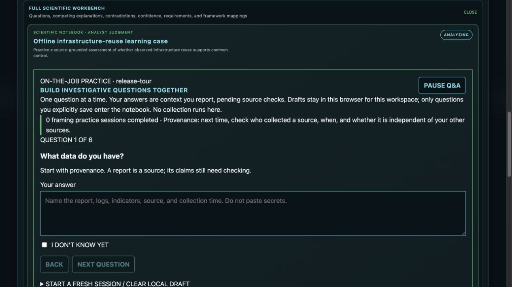

## Walkthrough: from reported context to a question

This exercise uses invented context, not a claim about a real incident. Create
an empty practice workspace with `workspace create framing-practice`, or use
a different unused name. The separate [offline learning case](LEARNING_WORKSPACE.md)
contains prepopulated source-marked evidence for the full collection-to-report
workflow.

1. Confirm the workspace name in the cockpit. Open **BUILD INVESTIGATIVE
   QUESTIONS · Q&A**. In **Novice**, coaching is available from the guided tip;
   at every guidance level it remains available in the full workbench.
2. Answer **What data do you have?**: “An exported proxy log from one host,
   collected by the network team for 10:00–11:00 UTC; clock synchronization is
   not checked.” Name the source and limitations before guessing a cause.
3. Answer **What happened?**: “The report says repeated connections occurred
   to a domain.” A report of a connection is reported context until you inspect
   and preserve the relevant source records.
4. At **Do you know how it started?**, select **I DON'T KNOW YET**. The earliest
   visible connection may follow an earlier event outside the log window.
5. Bound **Who or what is affected, and when?** to the one host and log window.
   At the decision prompt, say you need to decide whether further endpoint
   collection or containment is justified. At the alternatives prompt, include
   expected administration as well as unauthorized activity.
6. Choose **REVIEW DRAFT QUESTIONS**. Edit the suggestions to remove ambiguity
   and make the scope manageable. For example: “What evidence would distinguish
   expected administration from unauthorized connections by this host during
   the recorded hour?” Save only a question you intend to investigate using
   **SAVE THIS QUESTION**, then read the saved receipt.
7. In the notebook, record competing explanations and predictions. Ask what
   result would weaken each explanation. Identify missing clock, endpoint,
   and authorization information before collecting. Consult the
   [worked analytic example](analysis/WORKED_EXAMPLE.md) for the method.
8. If you bring in a report, preview it locally and explicitly admit the source
   or selected entities. Admission preserves provenance; it does not run
   enrichment or prove the report's claims. Review an admitted indicator and
   choose **Investigate** separately if you intend to send it to enabled services.
9. Revisit the question after collection. Was it answered, narrowed, or made
   obsolete? Record your reasoning and remaining uncertainty before producing
   a report.
10. Write a short reflection: “I separated the reported event from the suspected
    cause; the source window cannot establish the origin.” After at least one
    saved question, choose **COMPLETE PRACTICE** to record participation locally.

**PAUSE Q&A** keeps the draft. **BACK** lets you revisit earlier prompts before
saving; after a question is saved, its context cannot be edited through that
same review session. **CLEAR DRAFT AND START AGAIN** clears the browser draft
and reflection, while saved notebook questions remain. Browser storage failure
is reported; keep the page open if a draft is only in memory. On an interrupted
save, check the notebook before retrying so you do not duplicate a question.

Drafts are tied to a workspace name in this browser. Practice counts are
browser-local across sessions and are not a personnel assessment. A different
browser or device will not carry that draft or count. Do not put credentials,
private keys, or unnecessary personal data in coaching answers.

### Learn through repeated investigations

Practice becomes useful when you review the consequence of your choices.
After each case, compare your early question with the evidence you eventually
found. Identify an assumption you tested, an alternative you took seriously,
and an information gap that changed the decision. Ask a colleague or supervisor
to review a source-to-judgment chain when appropriate.

The rotating coaching lessons emphasize provenance, disconfirmation, scope,
and decision thresholds. Workflow participation can suggest lighter guidance
in Help after three and twelve completed workflows, but guidance never switches
automatically. **Adept** offers occasional tips; **Expert** suppresses unsolicited
tips. Those labels describe interface assistance, not certified competence.
See [learning through practice](analysis/LEARNING.md) for a repeatable review
routine and observable skills to discuss with a mentor.

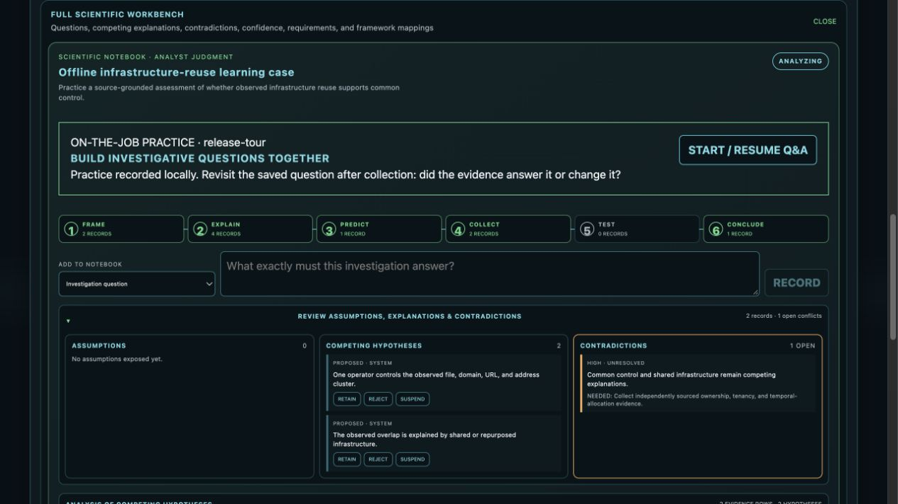

## Workspaces

Each investigation has an isolated SQLite workspace under `~/.pivotglass/`. Workspaces
store normalized STIX objects, relationships, module runs, notes, score events,
badges, and Dossier state.

```text
workspace list
workspace learn <name>
workspace create <name>
workspace switch <name>
workspace export <name>
workspace merge <source> <destination>
workspace clear <name> --confirm <name>
workspace delete <name> --confirm <name>
```

`workspace learn` creates and switches to a source-marked synthetic case using
no account, key, model, or network request. It exercises the real provenance,
graph, analytic-ledger, report, export, restart, and recovery paths; see the
[offline learning investigation](LEARNING_WORKSPACE.md). Creating a workspace
also switches to it. A merge adds evidence to the
destination without deleting either source. Deletion requires the exact
workspace name and cannot remove the active workspace; switch first.

`workspace clear <name> --confirm <name>` resets the investigation while preserving its empty
database, schema, and schema-version receipt. After confirmation it permanently
removes stored evidence, relationships, notes, analysis records, the approved
v9-v11 document/proposal/snapshot records, and uploaded document bytes. It does
not delete repository documentation, product plans, source code, or deferred
features. Framework-mapping records and external-integration execution receipts
retain their separate lifecycle and are outside this clear operation. `workspace delete` permanently removes the workspace database,
SQLite sidecars, and uploaded-document content directory. Both commands report
what they removed and fail loudly rather than claiming success after incomplete
cleanup. The browser and full-screen terminal require the repeated name shown
above. The direct `pivotglass basic` console and legacy chat-compatible terminal use a
default-no interactive confirmation and allow `workspace clear` without a name
to mean the active workspace.

## Enrichment and lifecycle state

The first indicator submitted in the command field starts applicable
enrichment immediately. Later indicators discovered in evidence can be added
to the investigation queue with **Queue**. **RUN NEXT** processes one queued
indicator; **RUN ALL** processes the queue in order.

The authoritative lifecycle is:

```text
planned → queued → running → succeeded | empty | failed | skipped | canceled
```

Lifecycle describes work, not the indicator. A source that needs a credential
you have not configured is `skipped` with the reason **not configured**; it is
a setup state, so it neither fails the investigation nor raises attention. Add
the key under **Menu → Models and API keys**. A key that is configured but
rejected remains a `failed` source fault that needs attention. `succeeded`
means the source returned successfully. `empty` means it returned no usable result. Neither
state proves that an indicator is safe or malicious.

Most integrations query intelligence already held by a provider. Pivotglass
does not issue direct DNS queries from the operator host. URLScan can submit a
URL or domain for an external browser scan. Review each provider's terms,
quotas, and handling before submitting sensitive or embargoed indicators.

Two additional, on-demand pivots help answer a question before expanding a
case: **Shodan DNS lookup** retrieves up to 30 provider-held DNS records for a
domain, retaining record times and an optional history choice; the request
may consume a Shodan query credit. **Search URLScan history** retrieves up to
10 existing scans for a domain or IPv4 address without starting a new scan.
Keep a historical match separate from a current observation, and inspect the
scan ID and time before treating it as relevant. A new URLScan scan remains a
separate submission that sends the URL to that service. Its default visibility
is unlisted; the analyst may specify a country and up to 10 tags.

The provider endpoint inventory and its scope decisions are in
[Provider API coverage](integrations/PROVIDER_API_COVERAGE.md).

During a terminal investigation, these yield controls remain available:

```text
stop             Stop after the current enrichment finishes
focus <source>   Move one source to the front of the pending queue
add <source>     Add a source to the pending queue
skip <source>    Remove a source from the pending queue
```

### Multi-hop pivoting

`pivot` follows what an enrichment returns, one ring at a time, within limits
you set. It works the same way in the web cockpit, the cyberdeck, and the
classic REPL.

```text
pivot <indicator> [<indicator> ...] [depth:1-3] [budget:1-200]
pivot status                 Show the run: requests, decisions, what is queued
pivot stop                   Halt after the current request
pivot skip <indicator>       Drop it and everything it would have led to
pivot focus <indicator>      Expand only that indicator's subtree; others wait
pivot unfocus                Put every queued indicator back in scope
pivot add <indicator>        Add a new seed at depth 0
```

A run starts from the indicators you name (depth 0) and asks every module that
subscribes to each indicator's type, the same subscription map the agent's
`autopivot` uses. Indicators the modules return become the next depth. With the
default `depth:1`, Pivotglass queries your seeds and then the indicators they
returned; anything found beyond that is recorded as *discovered, not
expanded*. Each further level multiplies the requests, so look at the first
ring before you go deeper. The maximum depth is 3.

`budget` is the maximum number of module requests (default 20, maximum 200).
One request is one call to one module, and a request that fails still counts
because it reached the service. Before each request:

1. A module that is not installed, is disabled, or has no credential is
   skipped as *readiness*. It costs nothing.
2. The pivot policy decides, as it does for `autopivot`: private, loopback,
   link-local and reserved values (such as `example.com` or 10.0.0.0/8), very
   popular domains, entries in your deny list, and results below the
   confidence threshold are rejected and cost nothing. The policy's budget gate
   ends the run when the budget is spent.

Every decision is kept with its reason: rejected by policy, not ready, skipped
by you, outside your focus, beyond the depth limit, over budget, or stopped.
`pivot status` lists them. Each indicator appears once per run, however many
modules return it.

Results are stored as ordinary evidence with the module and query that
produced them, exactly as a one-hop enrichment stores them; a run never also
triggers `autopivot` cascades underneath itself. The parent-child lineage of a
run is collection workflow (this module, asked about X, returned Y), not an
observation that X and Y are related. The pivot trail (`timeline pivots`)
records your seeds as investigated and each automated expansion as
`auto_pivoted`, recorded by the system rather than by you.

One run can be active per workspace.

- **Web cockpit.** The run streams into the investigation feed and the Activity
  pane. **Cancel** stops it after the current request. While the feed is
  running, the command field still accepts `pivot status`, `pivot stop`,
  `pivot skip|focus|add <indicator>` and `pivot unfocus`.
- **Cyberdeck.** The run executes in the background and prints one line per
  request to the transcript; type the controls at any time.
- **Classic REPL** (`pivotglass repl`). The run executes in the foreground and
  prints each request. Ctrl-C stops it after the current request; `pivot
  status` shows the last run afterwards.

## Evidence and provenance

Evidence details show the actual indicator, STIX type, normalized fields,
source, query target, collection time, stored relationships, and available
source metadata. Full indicator values wrap in evidence, queue, intake, and
graph displays rather than being truncated. Inspect the complete value and
source record before copying or acting on it.

Country flags and known-malware marks appear only when stored source data
supports them. Analyst notes are labeled as analyst-authored context. Inference
details identify their supporting evidence. Missing provenance remains visibly
unavailable rather than being reconstructed by a model.

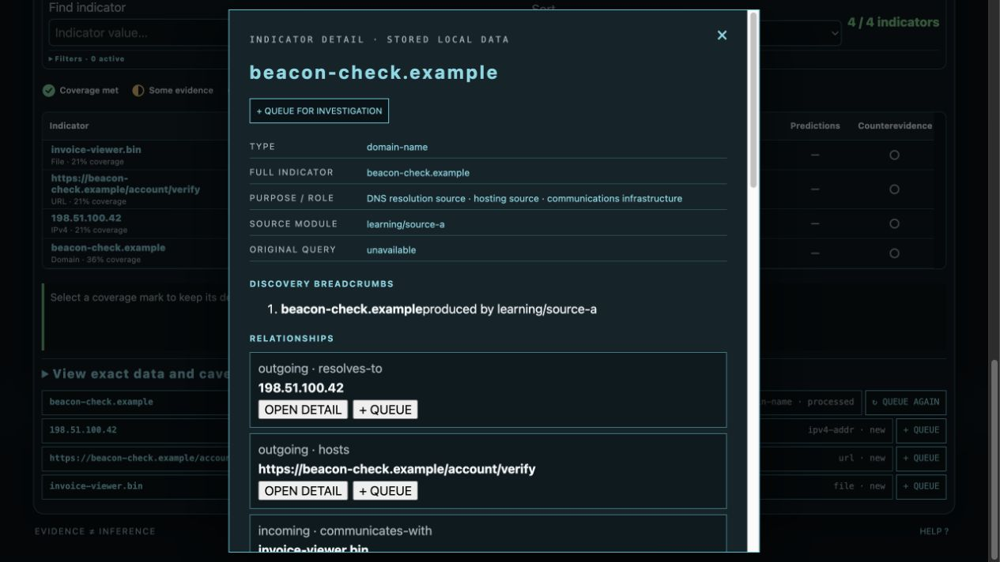

## The Dossier

The Dossier is a coverage summary, not a threat score. Its nine dimensions are:

| Dimension | Question |
| --- | --- |
| Identity | Who or what does the evidence identify? |
| TTPs | What techniques, tools, and tradecraft appear? |
| Infrastructure | What hosting, registration, certificate, or network habits appear? |
| Timing | When does activity occur? |
| Targeting | Which victims, sectors, or geographies appear? |
| Capability | What level and limits of capability does the evidence support? |
| Motivation | What motive, if any, is supported? |
| Predictions | What testable expectations have been recorded? |
| Denial | What deception or counter-analysis behavior appears? |

A dimension may be:

- **filled** — the implemented inference path has substantial supporting evidence;
- **partial** — some supporting evidence exists;
- **empty** — the implemented path found no support; or
- **deferred** — no applicable automated inference path exists yet.

These are coverage states. They are not confidence, severity, attribution, or a
malware verdict.

### Puzzle pieces: AI-proposed hypotheses

Once you have recorded the investigation question and collected some evidence,
open **Workbench → Review assumptions, explanations & contradictions** and
choose **Propose with AI**. The configured model reads a brief of the newest
150 observations (indicator, source, date, the key facts each source returned,
known-good labels, and local location) plus the stored relationships and the
hypotheses you already have. It proposes up to four competing explanations,
including a mundane one when the evidence allows it.

Each proposal is marked **AI proposal · inference** and shows:

- the observations it cites as support, and any that cut against it;
- the missing pieces that would most change the picture, which are also added
  as collection requirements awaiting your review; and
- the model's short rationale.

Pivotglass checks every citation against the brief. A proposal that cites
evidence it was not given, or that cites no supporting evidence, is discarded
before you see it. Text from sources is passed to the model as data inside a
fenced block, and the model is told not to follow instructions found there.

Nothing a model proposes is evidence. **Retain** is your acceptance: only then
do the cited observations become evidence links, each recording that you
retained a model proposal. **Reject** discards it; **Suspend** sets it aside.
The Dossier shows a **Puzzle pieces** line with retained hypotheses and the
proposals awaiting review. The model runs only when you ask, so you control cost,
timing, and which provider sees the case; with a cloud provider, the brief is
sent to that provider.

## Investigation Constellation

The Investigation Constellation is the persistent coverage table in Visual
Analysis. Stored indicators form rows, and the nine Dossier dimensions form
columns. The initial order is newest last-seen first.

Search and sort stay visible. Additional filters remain under **Filters** until
needed, where you can filter or sort by:

- indicator value;
- indicator type;
- mapped completeness;
- first seen;
- last seen; and
- direct relationship to a selected indicator.

Each row is calculated from the indicator and evidence in its direct graph
neighborhood. Relationship filters use only edges admitted by the graph
authority. Selecting an indicator opens its evidence; selecting a cell explains
the dimension state.

Each Dossier state is a compact coverage mark: green check **Coverage met**,
amber half-circle **Some evidence**, open circle **No evidence**, and dash
**No automated path**. The dash means analyst assessment is needed, not that
work is queued. These shapes remain recognizable without color.
Hover or keyboard focus opens a viewport-safe explainer with the full
dimension question, state meaning, and exact evidence count; selection pins the
same explanation below the matrix without shifting its rows. Tab enters the
grid once; use the arrow keys to move, Home or End to reach the first or last
dimension, and Enter or Space to pin the focused peg. Column headings are
focusable and announce the full dimension question. Enrichment Activity keeps the larger
three-channel RGB blocks because those cells represent job lifecycles rather
than Dossier coverage.

Country flags appear only for source-labelled location metadata on that
indicator. Hover or focus the indicator for the country name, source, and
retrieval time. This is infrastructure location—not attacker origin. Unknown
locations have no flag. Use **Open evidence & provenance** in selected-cell
details to inspect the underlying records. Escape dismisses a hover explainer.

The overall mapped value is navigation help, not confidence or a verdict.

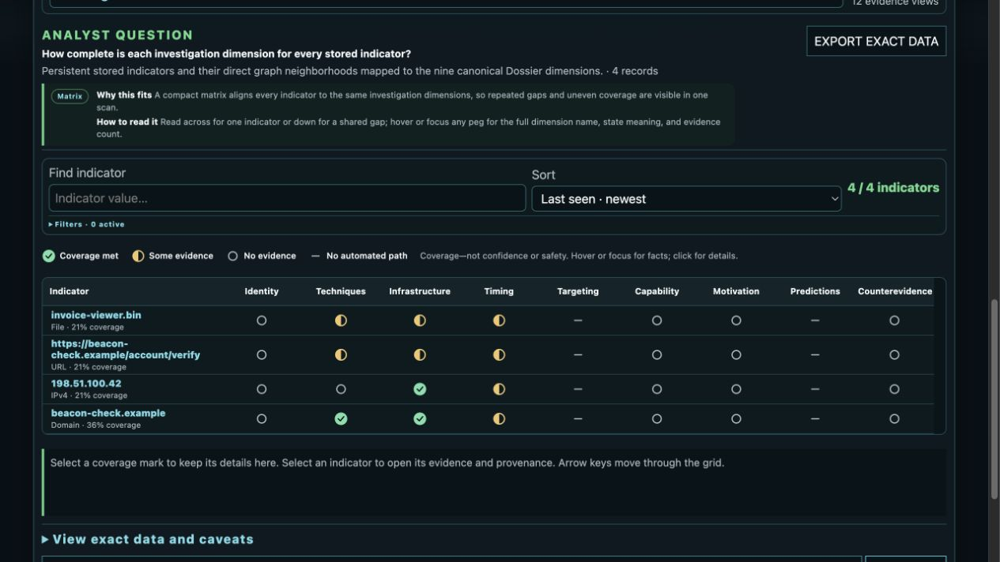

## Visual Analysis

Visual Analysis starts with the analyst question rather than a preferred chart
type. One header row holds the three views analysts open most (**Graph**,
**Coverage**, **Provenance**, each with its record count) and a single list of
every view; views with no records sink to the end of that list and say so. The
selected view's question is the headline, and the visualization fills the rest
of the window. Pivotglass currently provides:

- stored evidence types, compiled through Flint as a bar chart;
- one-Dossier completeness, compiled through Flint as a radar chart on an
  explicit 0–100 display scale;
- investigation activity by UTC calendar day;
- the Investigation Constellation;
- indicator-by-enrichment lifecycle activity;
- the force-directed relationship graph;
- the admitted connection-count distribution; and
- a PCA scatter view of similarity among indicator evidence-coverage profiles;
- an Analysis of Competing Hypotheses matrix over recorded evidence stances;
- a collapsible scientific-investigation hierarchy with exact path and depth;
  and
- a likelihood-interval view with separate analytic confidence context.

Every selected view states its source scope and missing-data policy, names the
visualization type, and provides two short notes: **Why this fits** explains the
deterministic selection, while **How to read it** explains the intended visual
comparison and its most important limit. **View exact data and caveats** opens
the accessible table behind the visual. **Export exact data** downloads the
same plotted rows as CSV, or the complete relationship nodes and edges as JSON.

See the [Visualization guide](VISUALIZATION_GUIDE.md) for the complete
question-to-view policy and the analytical guardrails for every chart family.

### Review a source in indicator focus mode

Open **Investigate**. The **Sources** bar sits directly under the command
field. Choose **Open file…**, drop a report anywhere on the bar, or choose
**Paste text** for an indicator list or an excerpt. The source opens at once
in indicator focus mode; nothing is stored yet.

Focus mode fills the window. The left side lists each distinct indicator once,
in the order the source first mentions it. The right side shows the source as
its author laid it out: HTML and Markdown rendered, PDF pages drawn, an email
with an HTML part rendered below its headers, and text, CSV, JSON, and
plain-text email shown as parsed text. The focused indicator is outlined
and scrolled into view; every other occurrence of a known indicator is lightly
marked.

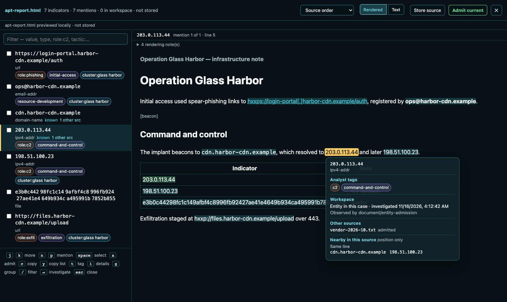

Hover any indicator, in the list or in the source, for **details on demand**.
The translucent card separates what is known by its basis:

| Section | Basis | Meaning |
| --- | --- | --- |
| Analyst tags | Analyst | Tags recorded on this indicator in this case |
| Workspace | Evidence | Whether the indicator is already an entity, its stored relationships, which sources observed it, and when it was last investigated |
| Other sources | Evidence | Other stored documents that mention it; identical bytes stored twice count once |
| Derived from the value | Structure | A URL's host, an email's domain, a parent domain, or a subdomain also found in this source |
| Nearby in this source | Position only | Indicators on the same line or in the same short paragraph. Nearness is a reading aid, not a relationship |

Press `i` to pin the card for the focused indicator; a pinned card can copy
the value, move focus to any related indicator, or prepare an investigation.
Long hashes are shown in groups of eight characters for comparison; a copy is
always the unbroken value. The rendered source follows your text size.

Focus mode is keyboard-first:

| Key | Action |
| --- | --- |
| `j` / `k` or arrows | Next or previous indicator |
| `n` / `p` | Next or previous mention of the same indicator |
| `space` | Select or deselect |
| `a` | Admit the selection, or the focused indicator when nothing is selected |
| `c` | Copy the focused indicator exactly as stored |
| `y` / `Y` | Copy the selection (or the focused indicator) one per line, defanged / exactly as stored |
| `e` | Export the indicators the list shows (after the filter) as CSV, defanged or live, or as a STIX 2.1 bundle. CSV columns: value, type, role, tactic, cluster, other tags, source document, observed by, first seen. STIX values are never defanged; tags, source and first seen travel as `x_pivotglass_*` properties, and values with no valid STIX form are left out and counted |
| `t` | Tag the selection or the focused indicator |
| `g` | Cycle grouping: source order, type, then each tag dimension |
| `/` | Filter by value, type, `dimension:value` such as `role:c2`, or `is:new` / `is:known` (already a workspace entity) |
| `v` | Switch between the rendered source and exact parser text |
| `Enter` | Close focus mode and put the indicator in the command field |
| `Esc` | Close the card, the palette, or focus mode |

Each row shows when the indicator was first observed in this workspace (`seen`),
which source observed it (`via`), its tags, and any list match. The **Sort**
menu offers source order, new first, first seen (oldest), and value, so triage
need not start from the first indicator the report happens to name. **Pivot N
new** adds every listed indicator that is not yet in the workspace to the
investigation queue.

**Admitting** stores the source and adds the selected indicators to the case
in one step, with provenance. **Store source** keeps the source without
admitting anything. A later admission from the same source reuses the stored
occurrence; the bytes are never stored twice. If storage succeeds but
admission is interrupted, the error says so and admitting again retries
against the stored source. Admission never runs enrichment. Investigating an
indicator stays an explicit choice.

#### Tag along several dimensions

Tags give the analyst a multidimensional clustering without a model choosing
membership. Each tag places one indicator on one dimension:

| Dimension | Values |
| --- | --- |
| Infrastructure role | c2, delivery, staging, exfil, phishing, hosting, victim, benign, or a new value |
| ATT&CK tactic | The 14 Enterprise tactics, TA0043 Reconnaissance through TA0040 Impact, or a technique ID such as `T1071.001` (checked against the installed ATT&CK content when present) |
| Cluster | Any analyst-chosen name, such as `cluster:glass harbor` |
| Review status | needs-pivot, reviewed, false-positive |

Press `t`, type a value such as `c2`, `initial-access`, or `cluster:kit a`,
and press Enter. Group by **ATT&CK tactic** to read the indicators in
attack-path order: tactics follow the ATT&CK matrix, an indicator with two
tactics appears under both, and untagged indicators come last. Click a tag
chip to remove it.

**Visualize → Attack path lanes** places every tagged indicator in the 14
tactic lanes, left to right. An indicator is placed by its tactic tag, by its
technique tag through the installed ATT&CK content, or, drawn dashed, by a role
tag that implies a stage (C2 → Command and Control, delivery and phishing →
Initial Access, exfiltration → Exfiltration, staging → Resource Development).
Role placements are inferences and are used only when the indicator has no
tactic or technique tag. Indicators tagged *Benign / noise* are left out. A
technique tag that cannot be resolved, for example because the ATT&CK content
is not installed, is listed as not placed. An empty lane means nothing is
tagged there, not that the stage did not happen. Click a chip to open its
evidence.

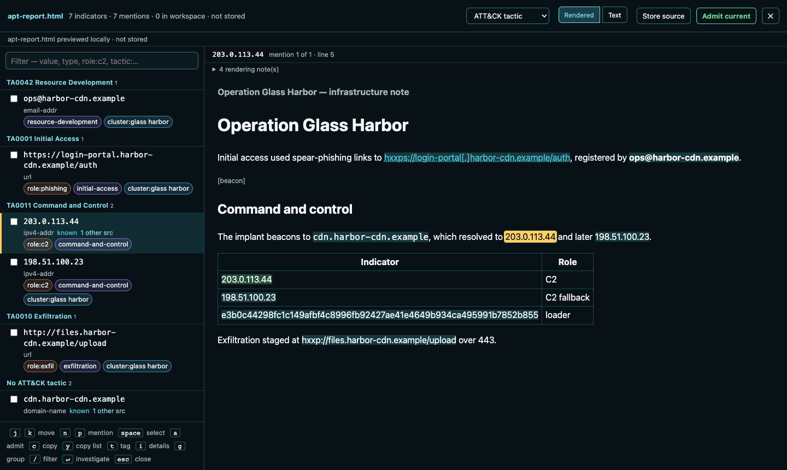

Tags belong to the indicator, not the document. A tag applied while reviewing
one report appears wherever that indicator is mentioned and remains after
admission. Every change is an append-only record of who tagged what and when.
A tag is analyst judgment; it is never presented as observed evidence.

#### Stored sources

**Stored sources** under the Sources bar lists every stored document with its
full SHA-256. Select one to reopen it in focus mode with its earlier
admissions marked. The content-addressed original lives beside the active
workspace database and is removed only by an exact-confirmed workspace clear
or delete.

#### Formats and limits

Sources up to 10 MiB are accepted. Text, Markdown, HTML, CSV, JSON, JSONL,
RFC 5322 email, and PDF have qualified parsers. JSON is recognized by content,
extension, or structured MIME type. UTF-8, UTF-16, and UTF-32 byte signatures
are supported. Duplicate keys and malformed records are never silently dropped
or repaired. PDF text is extracted page by page with `[page N]` markers;
pages without a text layer (scans) are named, not OCRed. An unreadable PDF can
still be stored as source evidence. Extraction is bounded at 2,000 candidates.

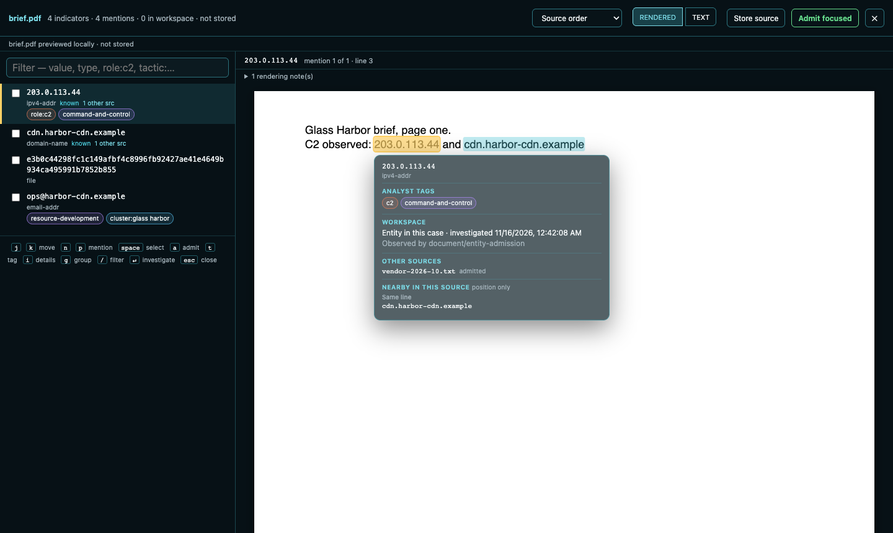

Rendered sources are hostile content and are shown under these rules:

- HTML and Markdown are rebuilt from an allowlist on the server. Scripts,
  event handlers, styles, forms, frames, and embedded objects are removed.
  Nothing in a rendering can fetch from the network. Images become labelled
  placeholders, and links are inert, with the original target shown on hover.
- The rendering is displayed in a sandboxed frame that is not allowed to run
  script, so even a sanitizer mistake cannot execute code.
- PDF pages are drawn by pdf.js. PDF JavaScript and XFA forms are never run.
- An email's HTML part goes through the same allowlist. Headers (Date, From,
  To, Cc, Subject) are shown above it as plain text. When a message carries
  both plain-text and HTML versions, both are shown, labelled, in message
  order, so every mention can still be located. Attachments are not rendered.
- When a rendered layout cannot locate an indicator exactly, focus mode says
  so and offers the exact parser-text view. It never guesses a location.

Parsed text proves only what the source contained. It does not prove the
source's claims.

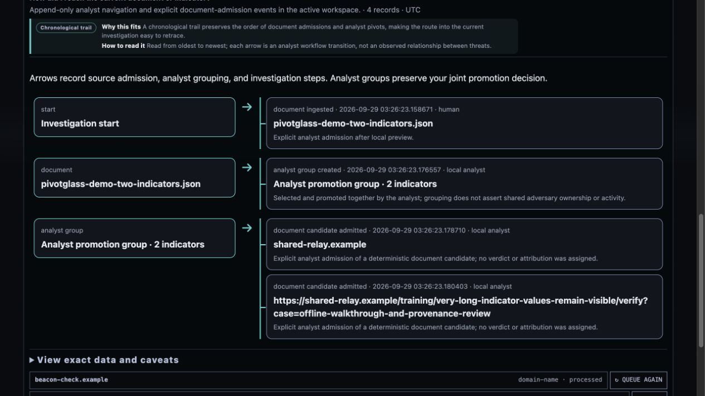

Read this path as the analyst's workflow: the document was admitted, two
candidates were selected together, and those selected strings became entities.
The group preserves the selection decision. It does not prove the source's
claims, common control, or an adversary relationship.

The layered investigation graph adds an epistemic node for each stored
document and candidate, a structural `contains-candidate` edge, and—only when
the exact normalized value already exists as admitted evidence—a labeled
bridge to that entity. These are provenance and review aids, not evidence that
the document's claim is true. `timeline pivots` and the **Chronological trail**
visualization show the append-only analyst path among documents and indicators.

Deferred dimensions remain in the table but are omitted from the radar shape
because they do not have an inference path. Radar values 0, 50, and 100 map to
empty, partial, and filled; they are not confidence scores.

The PCA view uses the same explicit 0, 50, and 100 coverage mapping, then
standardizes only dimensions that are available and vary across at least three
indicators. Deferred, unavailable, and zero-variance dimensions are excluded,
not guessed. The chart reports the variance explained by both axes and exposes
the exact input profile for every point. Nearby points have similar coverage
patterns; they are not necessarily connected, related to the same actor,
malicious, or supported with greater confidence.

The competing-hypotheses matrix appears after the scientific notebook has at
least two hypotheses and at least one observation or assertion linked directly
to a hypothesis. Green **supports**, red **contradicts**, amber **mixed**, and
dark **not assessed** cells always repeat their meaning with text and symbols.
An unassessed cell means no stance was recorded; it is not neutral evidence.
Open the exact-data table to read the analyst rationale and number of persisted
links behind each cell.

The investigation hierarchy organizes each persisted investigation beneath
the active workspace, then nests its questions, competing hypotheses, and
other scientific lifecycle items. Use the disclosure controls to collapse or
expand branches. The exact-data table preserves every parent, child, status,
depth, and full path. Tree membership does not mean that one record supports,
causes, or increases confidence in another.

The likelihood and confidence view presents repeated assessments as accessible
small multiples on one common 0–100% axis. It places each recorded likelihood range on a
0–100% axis. It shows the latest analytic confidence level, rationale, and
assessor beside the range without placing confidence on the probability axis.
Likelihood answers “how probable?” Confidence answers “how sound and
sufficient is the reasoning and evidence?” Pivotglass never merges them into a
single score. Invalid ranges are omitted and counted rather than silently
corrected.

### Record how evidence bears on an explanation

In the browser command field or full-screen terminal, use `analysis show` to
find the exact observation/assertion and hypothesis IDs. Then record one
interpretive link with a required rationale:

```text
analysis link observation <observation-id> hypothesis <hypothesis-id> supports | Explain which recorded fact supports this explanation and what it cannot establish.
analysis link assertion <assertion-id> hypothesis <hypothesis-id> contradicts | Explain why this authored claim is inconsistent with the explanation.
```

Replace every placeholder with an existing ledger ID and write your own
source-specific rationale. Source kinds are `observation` or `assertion`;
target kinds are `assertion` or `hypothesis`; stances are `supports` or
`contradicts`. The command validates those references and returns a link
receipt. It is available in the browser and full-screen terminal, not the
classic direct module console.

This link states the analyst's interpretation. It does not create a new source
observation, accept a hypothesis, set confidence, or run collection. Inspect
`analysis show` and the competing-hypotheses matrix after the receipt. Assess
every plausible hypothesis against the relevant evidence; a record can be
compatible with more than one explanation. The synthetic example deliberately
includes topology that supports both common control and shared infrastructure.

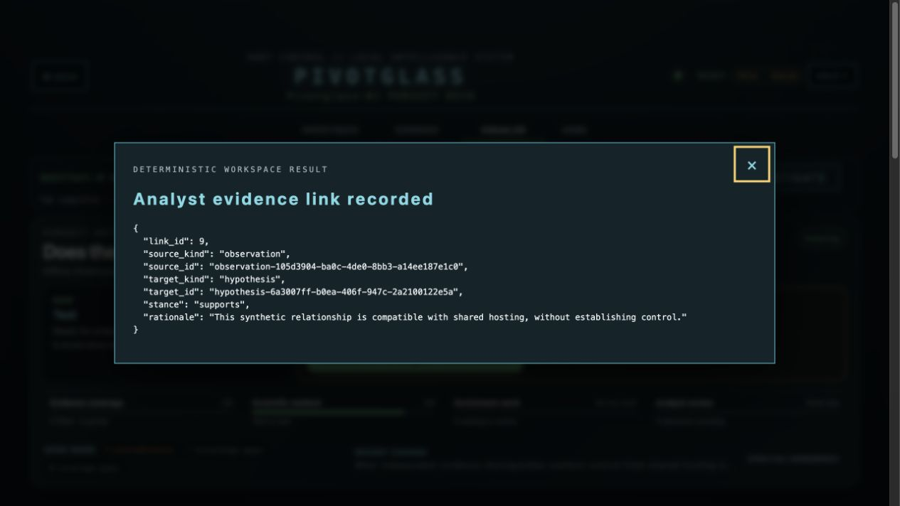

## Relationship graph

The relationship graph fills the window and fits itself to view; it refits as
the window changes until you pan or zoom. Node colour is indicator type, node
size is how many relationships it has, and only hubs, the selection, and
whatever you hover are labelled, so the largest nodes are where to look first.
Zoom spreads nodes apart without shrinking text. Hover a node to brighten its
neighbourhood and dim the rest. **Analyst groups** hides promotion groups,
which are your bookkeeping rather than adversary evidence. Stored STIX
relationships and conservative property pivots are visually distinguished.
Select a node to open the inspector beside the graph. Hold Shift, Command, or Control while selecting to build a temporary
multi-node set; the set can be pinned, unpinned, or cleared together. The last
node selected remains the primary selection for its presentation label and
evidence detail. Choose **Open evidence** to inspect the stored record. The
inspector also lists every analyst note on the node and adds new ones
(`Command/Control+Enter` saves); notes are analyst context, not evidence.
The evidence drawer's **Analyst notes** section reads and writes the same
notes, so a note added in either place appears in both.
**Rename on this graph** changes only the label drawn here.
Double-click a connected node, or use the selected-node control, to collapse or
expand its direct connections. This changes only the bounded view: hidden
nodes remain in the accessible inventory and exact-data export. **Show all
connections** clears every temporary collapse.

When five or more nodes of one type connect only to the same hub (an analyst
group of 150 addresses, a domain resolving to a pool), they draw as one bundle
node such as "47 IPv4". Click a bundle to expand it; **Bundle leaves** draws
them as bundles again. A selected, pinned, or filter-matched node is never
hidden in a bundle, and the accessible inventory lists bundled nodes as
**Bundled** with their exact relationship counts. Bundles change only the view.

With exactly two nodes selected, **ANNOTATED ANALYST RELATION** records a
directional judgment from the first selection to the second. Enter a bounded
lowercase relationship such as `possibly-controlled-by` and a required
annotation explaining the basis. Manual relations are amber dashed edges and
remain analyst assertions; they are not written as observed STIX
relationships. The equivalent shared command is `analysis relation
<subject-ref> <predicate> <object-ref> \| <annotation>`.

Open **Review analyst relations** to correct an active manual edge. **REVISE**
creates a replacement judgment and marks the former assertion superseded;
**RETRACT** withdraws the active edge. Both require a human explanation, retain
the original assertion, and append a correction-history entry. They do not
edit or delete observed evidence.

Dragging, panning, zooming, filtering, centering, pinning, selecting, and
collapsing change only the presentation. They do not alter evidence. Selection is deliberately
temporary and is not included in saved layouts. Open **Layouts**, enter a name,
and choose **Save** to keep an arrangement in the active workspace. Loading an older
view reports added or absent nodes when the evidence graph has changed. Large
workspaces use a bounded overview. If no supported edge exists, Pivotglass says
so and keeps the evidence unconnected rather than manufacturing a relationship
from proximity.

The undo and redo arrows retain up to 50 presentation checkpoints for
node movement, viewport changes, pins, display labels, and collapsed
connections. Use `Command/Control+Z` and `Shift+Command/Control+Z` when focus is
in the graph rather than a text field. Analytic evidence, relations, assertions,
and correction history are intentionally outside this undo boundary.

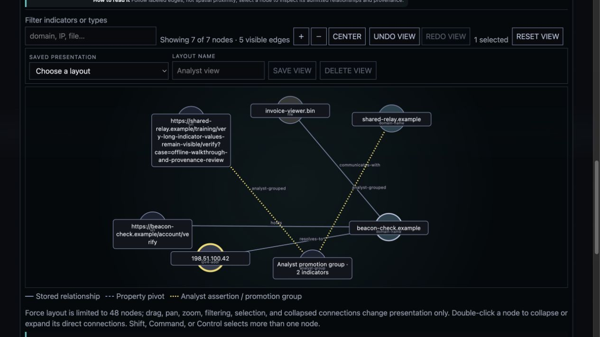

In this example, the newly admitted domain and long URL share an analyst
promotion group. The dotted edges state that they were promoted together;
they do not assert that the domain hosts the URL or that one actor controls
both. Read the edge label and provenance before using any connection in a
hypothesis.


## Reports and exports

```text
report
report types
report investigation-report json tlp:green
report issue investigation-report draft | First look for the SOC lead
report issue investigation-report final | Added the hosting records
report history
report open PG-INV-2026-0001 2 stix
export json
export csv
export stix
export gexf
export csv --defang yes
export json --defang no
```

A report is built from the active workspace each time you ask for it. It states
current evidence and visible gaps; it does not turn absent data into findings.

**Preview and issue.** `report` (or `report <type>`) is a preview: nothing is
recorded, and the header says "Preview — not issued". `report issue <type>`
records an issued version: it gets an ID such as `PG-INV-2026-0001`, a version,
DRAFT or FINAL status, an entry in the revision history, and a SHA-256 hash of
its content. Issuing the same type again for the same investigation adds the
next version under the same ID and keeps the marking unless you change it.
`report open <id> [version]` reads an issued version back exactly as it was
issued, and refuses if the stored content no longer matches its hash. Issued
reports are kept when the workspace is cleared, like other publication records.
A report with model drafts still awaiting review can only be issued as DRAFT.

**Report header and marking.** Every report opens with its ID and status, the
TLP 2.0 and PAP markings with their meaning, the audience, the requirement it
addresses, the producer, and the sources. Each type has a default marking;
`tlp:<CLEAR|GREEN|AMBER|AMBER+STRICT|RED>` and `pap:<CLEAR|GREEN|AMBER|RED>`
override it. The report then states whether it is **Complete** or
**Incomplete**, naming any required section that has no content.

**Sections say where they come from.** Each section ends with its provenance:
evidence (collected and cited), method (a deterministic computation), analyst
(written by you), model draft, or organisation input. Every report ends with
**Gaps and Limitations** (your recorded knowledge gaps and limitations, plus
every section that came back empty or partial, and any record that could not be
read) and **Sources** (each collection source with its runs, object count, and
Admiralty rating). Pivotglass does not rate sources yet, so they show as F6,
"cannot be judged".

**Formats.** Markdown is for reading and defangs indicators (`hxxps[:]//`,
`example[.]com`). JSON and STIX 2.1 are for tools and carry values unchanged.
The STIX bundle contains the report object, the producer identity, the official
TLP 2.0 marking definition, and the reported indicators; PAP, which STIX has no
marking for, travels as `x_pivotglass_pap`. In the cockpit, the report dialog
has a picker for the type, format and marking, plus **Preview**, **Issue
draft**, **Issue final** and **Issued reports**. Markdown opens in the dialog;
JSON and STIX download as files. **SAVE MARKDOWN** and **PRINT / SAVE PDF**
remain for the Markdown shown.

`report types` lists every type. The **Investigation Report** is the complete
record of a workspace's investigation and replaces the former dossier report
with the same content. Eighteen CTI report types, from the Executive Threat
Briefing to the Defensive Coverage Assessment, are defined in the
[report reference](reports/README.md); a type whose sections are not built yet
is listed but will not render, and the picker shows which issue builds it.

**Writing report sections.** Some sections are yours to write. Each entry is
recorded in the analytic ledger with you as its author:

```text
report write threat_summary | <two or three sentences>
report write attack_narrative | <the intrusion end to end>
report write technical_mechanism | <the flaw and its preconditions>
report write triage_actions | <an extra triage step>
report write remediation_notes | <compensating controls and detection>
report severity high | <why>
report recommend 1 | <action> | <owner> | <due YYYY-MM-DD> | <expected outcome>
report write hunt_hypothesis | <behaviour, technique, and what would refute it>
report outcome refuted | <what the hunt searched and did not find>
report yara <sample sha256> | <reference> | <string>; <string>; <string>
report validate <rule-or-query-id> passed | <what it was tested against>
report control delivery detected | <telemetry source and what the control did>
report write bluf | <two sentences for leadership>
report risk high moderate | <why; severity, then confidence>
report scenario most-likely likely high | <description> | <signposts>
report risk-scenario likely critical missed | <scenario> | <recommended control> | <residual risk>
```

Likelihood terms are the ICD 203 scale (`almost_no_chance`, `very_unlikely`,
`unlikely`, `roughly_even_chance`, `likely`, `very_likely`, `almost_certain`);
confidence is `low`, `moderate` or `high`, and the two are always separate.

Detection content is generated from the indicators you would block: Sigma
(status `experimental` until you record a passed validation, then `test`),
Suricata (sids in the local range 1000000-1999999, stable per indicator), and
SPL, KQL and EQL hunt queries. YARA rules are built only from strings you
supply from a sample. `report detection-signature-bundle sigma|suricata|yara`
downloads the rule file. Nothing is shown as tested until you record a test.

**Organisation input.** Some sections need facts only you have: what the
organisation runs, which controls see which techniques, how its network
connects, and what its logs recorded. Import them per workspace:

```text
org import org.yaml          # profile, controls and environment model
org telemetry events.csv     # host and network events for the forensic timeline
org show                     # what is held, from which file, when
org share-with-model on|off  # off by default
```

The file format is in `src/pivotglass/reports/org.py` and in the example at
`tests/fixtures/reports/org.yaml`. Controls score visibility, alerting and
prevention 0-2; the gap status is derived from those scores, never typed.
Telemetry timestamps must carry a time zone and are stored in UTC. Missing
input is shown as missing in the report, never estimated. Organisation input
is withheld from the model (its sections read "Withheld") unless you turn
sharing on; your own report view always shows it. `workspace clear` keeps it.

**Actor reports.** The Threat Actor Profile and the Actor Capability Radar read
analyst claims about an actor, recorded as
`analysis claim judgment actor:<name> <predicate> <value> | <basis>` (for
example `alias`, `motivation`, `targets-sector`, `campaign`, `uses-malware`, or
`capability:malware 4`). Link evidence to each claim so the report can cite it.
If more than one actor has claims, name one: `report threat-actor-profile
actor:<name>`. The [report reference](reports/README.md#analyst-claims) lists
every predicate and the capability rubric's axes.

Structured technique runs retain their recorded inputs and outputs in the report,
alongside the actual analyst disposition. A completed run may still be pending
review. These are authored analytical records; field completeness does not
establish correctness, observed evidence, or attribution.

JSON and CSV support inspection and downstream analysis. STIX supports
structured exchange. GEXF supports graph tools such as Gephi. Exports can
contain raw indicators and provider-derived information; review them before
sharing.

The browser export chooser makes the same decision explicit: **Preserve
indicators** keeps canonical values, while **Defang indicators** writes common
analyst-safe spellings such as `1[.]1[.]1[.]1` and `hxxp[:]//host[.]test`.
Only typed indicator values are changed; evidence, provenance, and raw source
text are not rewritten. Defanged downloads include `-defanged` in the filename.

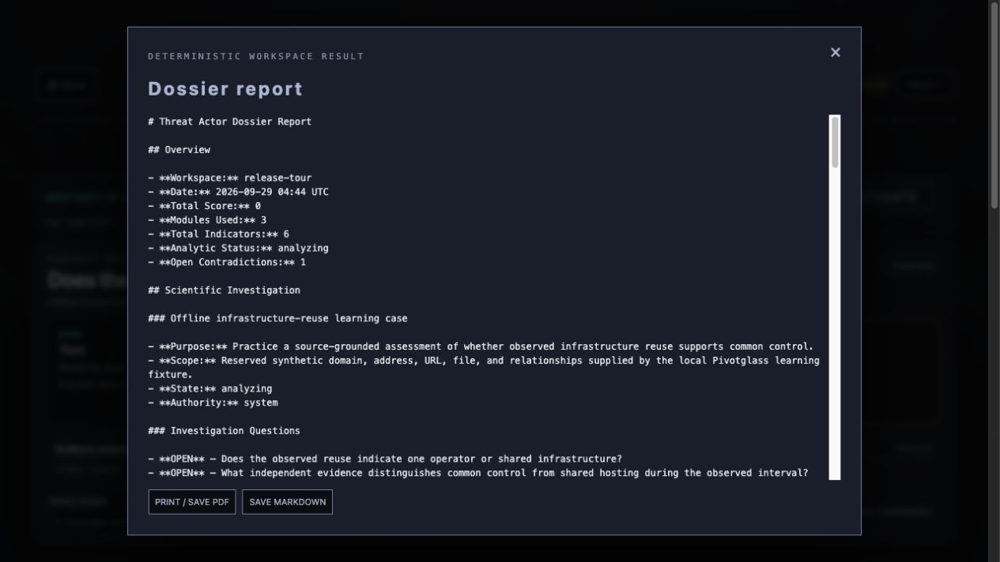

## Review, correct, and hand off a case

### Correct the record without hiding the history

Read a consequential claim from its evidence rather than its graph position.
If your interpretation changes, record the reason and the changed judgment.
A saved presentation is only a view; undo cannot reverse analytical work.

| Problem discovered | Corrective action | Preserved boundary |
| --- | --- | --- |
| A manual graph relation is wrong | Use **Review analyst relations**, or `analysis relation-retract <assertion-id> \| <reason>` | The former assertion and human reason remain in history |
| A manual relation needs a replacement | Use the review control or `analysis relation-revise <assertion-id> <subject-ref> <predicate> <object-ref> \| <annotation>` | The replacement supersedes the earlier authored judgment |
| An early hypothesis is unsupported | Record an explicit reject or suspend disposition and explain the basis in the notebook | Collected observations are retained |
| Two records appear inconsistent | Preserve the conflict and what evidence would resolve it; inspect event time and source dependence | A contradiction is not silently removed to make the story coherent |
| Enrichment failed | Inspect **Activity & Errors** and retry deliberately when appropriate | Failure remains distinct from an empty or safe result |
| Source admission succeeded but entity admission was interrupted | Read both receipts and use **Retry entity admission** | Retry refers to the stored source and avoids duplicate admission |
| A Q&A save response was interrupted | Inspect `analysis show` before another save | A retained draft is not proof the save failed |
| A chart appears to omit records | Read its visible count, scope, filter, and exact-data table/export | A bounded presentation does not remove stored case records |

Questions, assertions, and hypotheses have different lifecycles. Use the
specific command's supported transition, rather than assuming every record can
be edited in place. Never clear a valuable workspace as a way to repair one
judgment. [Failure and recovery](FAILURE_RECOVERY.md) covers rejected migrations,
provider outages, stale assets, and malformed intake.

### Prepare a handoff that someone can use

Before `report generate`, check these seven elements against the notebook:

1. **Decision and scope:** who needs the answer, the affected systems, and the
   time window the evidence actually covers.
2. **Judgment:** the proposition assessed and its explicit analyst disposition.
3. **Evidence:** exact observations, sources, collection times, source quality,
   and independence limitations behind the claim.
4. **Alternatives:** the serious competing explanation and what would
   distinguish it from the favored one.
5. **Uncertainty:** likelihood and confidence expressed separately, with a
   rationale; unresolved contradictions and missing visibility remain visible.
6. **Next work:** a collection requirement, owner in your handoff text, and
   the finding or timebox that should trigger review or stop collection.
7. **Handling:** intended recipient, provider restrictions, indicators, source
   text, and personal information reviewed before sharing.

Pivotglass records analysis and provides report/export mechanisms. It does not
assign an organizational owner, enforce your classification policy, or prove
that a recipient has acted. Complete those handoff responsibilities in your
operating process.

Choose the export that fits the recipient: STIX for entity/evidence exchange,
GEXF for graph analysis, JSON for structured records, or CSV for reviewable
rows. **EXPORT EXACT DATA** concerns the view you are inspecting; it is not a
substitute for all workspace records. Defanging changes typed indicator
presentation, not the sensitivity of the source material.

`workspace export <name>` carries workspace records and metadata. It does not
include original content-addressed source-document bytes and is not a full
application backup. A recoverable backup includes the stopped application data
tree, configuration, workspace databases and relevant sidecars, and document
content; follow [operations and maintenance](operations/OPERATIONS.md).

## Configuration and models

Configuration is stored under `~/.pivotglass/config.toml` with restrictive permissions.
The Pivotglass **CONFIGURATION** dialog can inspect masked state, save and test
credentials, enable or disable intelligence sources, enable or disable model
synthesis, list account-visible models, and select a model.

A secret typed into Configuration exists transiently in the password field and
explicit local save/test request. Stored secrets are not returned by routine
polling or repopulated into the form. Environment-owned credentials remain
read-only. Secrets must not enter command history, notes, exports, screenshots,
or model prompts.

From a terminal, the same configuration is available without the browser:

```bash
pivotglass config show               # services, enabled state, where each key comes from
pivotglass config set greynoise      # prompts for the key without echoing it
pivotglass config check greynoise    # tests the key and endpoint
pivotglass config disable sans_isc   # or enable
```

`config set` takes a service id (`threatfox`) or a stored key name (`abusech`)
and never accepts the key as an argument, so it stays out of shell history. Piped
input is read one value per line, for example from a password manager. In the
cockpit command bar, `config set` points here instead of accepting a key.

The model catalog combines a provider's availability response with local
LiteLLM capability metadata when available. Strengths and limitations are
evidence-proportional notes, not rankings. A visible model can still lack
quota, perform poorly for a case, respond slowly, or change at the provider.

### Known-good and shared infrastructure

Reports and pivots pull in indicators that are not malicious: public DNS
resolvers such as `8.8.8.8`, certificate revocation servers, the hash of an
empty file, research scanners. Pivotglass recognises them offline against a
bundled subset of the [MISP warninglists](https://github.com/MISP/misp-warninglists)
(CC0 1.0) and labels them wherever the indicator appears: the focus-mode list
and details card, the coverage matrix, the relationship graph (dashed and
faded), and the evidence drawer. Each label names the list and its version.

| Label | Examples | Can be set aside |
|---|---|---|
| Known good | Public DNS resolver, CRL/OCSP, connectivity check, IP-echo service, security-vendor blog, Tranco top-10k site, empty-file and EICAR hashes, common IoC false positives, a file CIRCL hashlookup knows | Yes |
| Internet scanner | Shodan, Censys, Shadowserver, Rapid7 Sonar ranges | Yes |
| Shared infrastructure | AWS, Google Cloud, Azure, Cloudflare, Akamai, Fastly address space; URL shorteners; dynamic DNS; parking servers; a URL on a popular site; a subdomain of any listed domain | No |
| Sinkhole | Known sinkhole addresses | No |
| Known file, also reported malicious | hashlookup knows the file but a source lists it as malicious | No |
| Reserved or special-purpose value | Documentation ranges (RFC 5737, 3849), private, loopback and other non-global addresses; `.example`, `.test`, `.invalid`, `.localhost` and `example.com/net/org` domains, URLs and email addresses. Built in, not from a warninglist | No: a private address in a report may be the victim's own host |

A label is context, never a verdict. **Set aside** (on a known indicator in the
evidence drawer, or **Set aside N known** in focus mode for the whole source)
tags it *Benign / noise* with a note naming the list, so you can filter it out;
remove the tag to bring it back. Shared infrastructure is never offered for set
aside: malware is hosted on cloud services and popular platforms, and a
subdomain of `blogspot.com` is not `blogspot.com`. A sinkhole match usually
means the domain was malicious and has been taken over.

The bundle is refreshed each minor release with
`uv run python scripts/update_warninglists.py`, which records the upstream
commit.

### Geolocation data

Every public IP shows a small flag, country, city, and network (ASN) in the
coverage matrix, the relationship graph, and the evidence drawer. The location
comes from local DB-IP Lite databases, so no case IP is sent anywhere to be
located. Download them once from **Configuration → Geolocation data**
(about 65 MB, stored in `~/.pivotglass/geo/`) and use **Check for update**
monthly. A location reported by an enrichment source is shown in preference
and keeps its source label; the local result is labelled with the database
edition, e.g. `DB-IP Lite 2026-11 (local)`. Location describes where
infrastructure is hosted, not who operates it. IP geolocation by
[DB-IP](https://db-ip.com), licensed CC BY 4.0.

The **IP to ASN** module (`osint/ip_asn`) also needs no key and makes no
request: it reads the same local DB-IP Lite ASN database and records the AS
number, AS organisation, and matching network prefix on the IP, with the AS as
its own observation linked to the address. If the databases are not installed
it says so instead of returning nothing. An ASN names a network operator, not
an actor.

### API base URLs and gateways

Every model provider and intelligence service shows its **API base URL** in
Configuration. The field starts with the default; replace it to route that
service through an API gateway or proxy (for example a LiteLLM proxy, Cloudflare
AI Gateway, or a corporate egress gateway) and press **Save**. The credential
test, model list, enrichment lookups, and model calls for that service all use
the saved URL. **Use default** removes the override. Overrides must use
`https://`; `http://` is accepted only for `localhost` gateways, and a URL may
not contain credentials, a query, or a fragment.

Providers:

| Provider | Default base URL | Notes |
|---|---|---|
| Anthropic | `https://api.anthropic.com` | |
| OpenAI | `https://api.openai.com/v1` | |
| OpenRouter | `https://openrouter.ai/api/v1` | |
| Google (Gemini) | `https://generativelanguage.googleapis.com/v1beta` | The free tier may use prompts for training; use a paid key for case data. |
| Ollama (local) | `http://localhost:11434` | Default when nothing is configured: `ollama/qwen3.5:9b`. On 32 GB or more, `qwen3.6:35b` is stronger. |
| Azure OpenAI / AI Foundry | none; enter your resource's v1 endpoint | e.g. `https://NAME.openai.azure.com/openai/v1` |
| OpenAI-compatible endpoint | none; enter it | Any `/v1` OpenAI-style API: LiteLLM proxy, Mistral, Groq, Together, xAI. |
| Local OpenAI-compatible | `http://localhost:1234/v1` | LM Studio; change the port for mlx_lm or llama.cpp server. |

ThreatFox, URLhaus, and MalwareBazaar need an abuse.ch Auth-Key, free from
an abuse.ch account at `https://auth.abuse.ch/`. One key works for all three:
enter it on any of their cards and the others use it, or set
`PIVOTGLASS_ABUSECH_API_KEY`. Each keeps its own Enabled toggle, base URL, and
**Test**. Without a key, a hunt records them as *not configured* rather than
failing.

| Service (id) | Default base URL |
|---|---|
| ThreatFox (`threatfox`) | `https://threatfox-api.abuse.ch/api/v1` |
| URLhaus (`urlhaus`) | `https://urlhaus-api.abuse.ch/v1` |
| MalwareBazaar (`malwarebazaar`) | `https://mb-api.abuse.ch/api/v1` |

Keyless context sources need no credential. They appear under Intelligence
APIs with an Enabled toggle, a base URL, and a **Test** that queries a public
value (8.8.8.8 or example.com). Each sends the User-Agent `pivotglass/<version>`
and nothing that identifies you. A source with nothing on record returns no
result rather than an error; their findings are context from the named source,
never a verdict.

| Service (id) | Default base URL | Accepts | What it records |
|---|---|---|---|
| Mnemonic passive DNS (`mnemonic_pdns`) | `https://api.mnemonic.no` | domain, IP | Historical resolutions with first/last seen and counts. Public tier: 10 requests per minute, 1000 per day, TLP:WHITE data only; so it is not an auto-pivot source. |
| Shodan InternetDB (`shodan_internetdb`) | `https://internetdb.shodan.io` | IP | Open ports, hostnames, CPEs, Shodan tags, and CVEs Shodan associates with the reported versions (not confirmed). Refreshed weekly. |
| SANS ISC (`sans_isc`) | `https://isc.sans.edu/api` | IPv4 | DShield sensor reports and targets, first/last reported, AS, network, and ISC feeds the address appears in (for example open resolvers). |
| RDAP (`rdap`) | `https://rdap.org` | domain, IP | Registrar, registration, expiry, and last-changed dates, status, nameservers; for IPs the network name, range, country, and registrant or abuse organisation. rdap.org redirects to the authoritative registry; personal names, e-mail addresses, and phone numbers are not recorded. |
| DNS over HTTPS (`dns_doh`) | `https://cloudflare-dns.com` | domain | Live A, AAAA, NS, MX, TXT, and CNAME records and the response status (NXDOMAIN is recorded, not an error). Pivotglass never resolves from your machine: Cloudflare's resolver asks the authoritative servers, so the adversary sees Cloudflare, not you; your address is visible to Cloudflare as an HTTPS client. A snapshot from one resolver at query time, not DNS history. A, AAAA, NS, MX, and CNAME answers become pivotable observations (at most 25 per type); TXT stays a property and is never parsed into indicators. |
| Wayback Machine (`wayback`) | `https://web.archive.org` | domain, URL | First and last capture with archive links and the number of months with captures. |
| CIRCL hashlookup (`hashlookup`) | `https://hashlookup.circl.lu` | MD5, SHA-1, SHA-256 | Known file (NSRL and other known-software sets), context not a verdict: matched sets, file name, product, trust score, and any known-malicious annotation. |
| CISA KEV (`cisa_kev`) | `https://www.cisa.gov` | CVE | Whether the CVE is in the Known Exploited Vulnerabilities catalog, always answered: listed (date added, due date, ransomware use, vendor, product, required action) or *not listed in catalog version X*. The whole catalog is fetched once and cached for 6 hours. Listing means exploitation was observed; it does not mean a host in your case is affected. |
| FIRST EPSS (`first_epss`) | `https://api.first.org` | CVE | Exploit Prediction Scoring System score and percentile (0-1) with the model date. A prediction of exploitation activity in the next 30 days, not an observation. No score returns no result. |
| NVD CVE (`nvd_cve`) | `https://services.nvd.nist.gov` | CVE | English description, CVSS vectors and scores (v2.0, v3.x, v4.0) per source, CWEs, affected product versions (up to 200), and references (up to 100). Unauthenticated NVD allows 5 requests per 30 seconds; Pivotglass queues requests to stay inside that, and reports HTTP 403, 429, or 503 as *rate limited, retry later*. |

A CVE identifier (`CVE-2024-0001`, any case) is an indicator type. The three vulnerability
sources accept only CVEs. CVEs that Shodan InternetDB or the Shodan host module report
for an IP become pivots to them. The workspace keeps one vulnerability object per CVE and
each source's own answer as a separate evidence observation. A CVE does not fill a dossier
slot by itself: CVEs on a scanned host describe its exposure, not an actor's tradecraft.

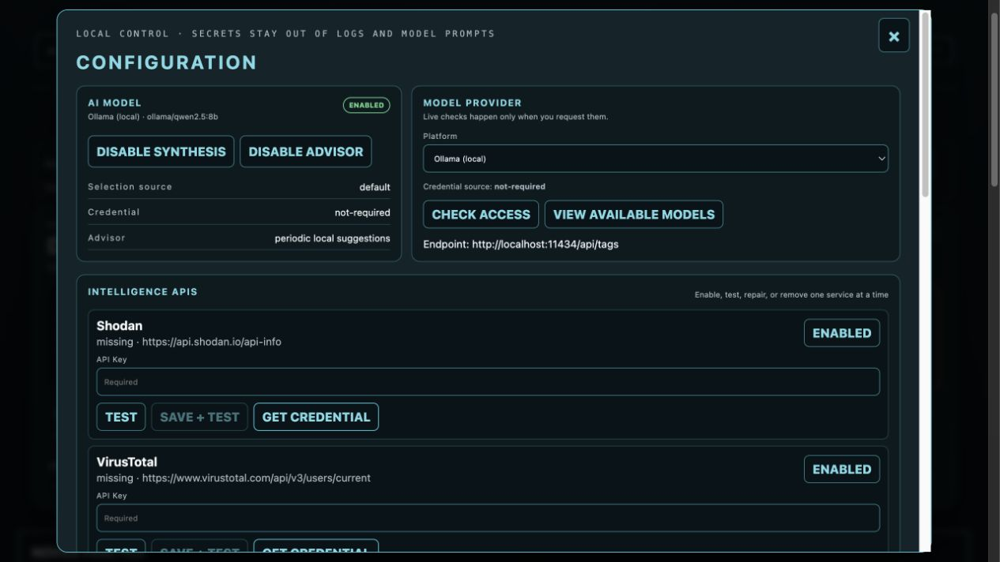

### Model commands

```text
model show
model providers
model list
model check
model select [provider] <provider-model-id>
model enable
model disable
model repair
model configure
model advisor on
model advisor off
```

`model show`, enable/disable, and repair use local state. `model list`, check,
selection, and **SAVE + TEST** contact the selected provider only when
explicitly requested.

When enabled, the Configuration Advisor may offer one non-modal,
character-voiced suggestion after an extended pause, based only on masked local state. It is labeled
**Narration**, makes no model request, spends no tokens, adds no evidence, and
does not take focus.

Field Guidance uses the same boundary for investigation ideas: after five
minutes without meaningful activity in Full narration mode, or eight minutes
in Brief mode, it may select a bounded action from visible local gaps,
challenges, visualizations, or attention records and render the idea in the
active character's voice. At least fifteen minutes separates suggestions.
Typing, clicking, scrolling, touch, new evidence, and investigation state
changes reset the idle timer and dismiss visible guidance. The
Analyst Advisor is fixed near the top of the current viewport, above the working
surface but without moving keyboard focus. Character-and-topic artwork makes
the suggestion identifiable before it is read. It is labeled **Narration, not
evidence**, never runs the action automatically, and can be dismissed or
disabled with the Narration control.

Every card also offers **Read Aloud**. The optional automatic Advisor Voice
setting is off by default and persists locally when enabled. Speech uses
AI-generated speech through a configured OpenAI key, or a browser or
operating-system voice with character-specific rate and pitch. When AI speech
is available, the visible narration text is sent to OpenAI for synthesis.
Pivotglass does not clone an actor, celebrity, or fictional performance.
Speech stops when the card is dismissed, audio is disabled, or the character
changes.

## Activity, errors, and degraded operation

Pivotglass keeps user-relevant enrichment lifecycle events in the scrolling
**Activity & Errors** panel. It includes timestamps, severity, component,
sanitized summary, and the next action when one is available. The view can be
filtered, paused, cleared without deleting history, and downloaded as sanitized
JSON.

A clickable `debug.log · <diagnostic-id>` reference opens only the sanitized
record for that exact eight-character diagnostic identifier. The browser never
receives raw exception strings, tracebacks, credentials, query strings, private
file paths, or arbitrary log-file contents. Full local debugging material stays
in `~/.pivotglass/debug.log`.

The panel's **Operational Authorities** section identifies which component owns
each action and labels it Ready, Degraded, Disabled, Missing Configuration, or
Unavailable. This registry is a read-only projection: it performs no background
provider tests. When remote sources are unavailable, stored evidence, workspace
search, analytic methods, and reports remain usable; Pivotglass skips the source
explicitly instead of fabricating telemetry or replacing it with model output.

### Intelligence-service commands

```text
config show
config check <service>
config enable <service>
config disable <service>
config repair
config configure
```

Disabling a source prevents it from running while preserving its stored
credential. WHOIS, crt.sh, and the keyless context sources (Mnemonic passive
DNS, Shodan InternetDB, SANS ISC, RDAP, Wayback Machine, CIRCL hashlookup, CISA KEV,
FIRST EPSS, NVD CVE)
require no API credential; the system WHOIS module does require a local `whois`
executable.

Common non-interactive overrides include:

```bash
export PIVOTGLASS_MODEL=anthropic/claude-sonnet-4-5
export PIVOTGLASS_ANTHROPIC_API_KEY=...
export PIVOTGLASS_SHODAN_API_KEY=...
pivotglass
```

Pivotglass also recognizes documented vendor environment variables. Never
commit credentials to the repository.

## Command reference

Pivotglass and the terminal interface share this deterministic command grammar:

| Command | Purpose |
| --- | --- |
| `workspace list` | List workspaces |
| `workspace learn <name>` | Create and switch to a complete offline synthetic investigation |
| `workspace create <name>` | Create and switch to a workspace |
| `workspace switch <name>` | Switch workspaces |
| `workspace schema [name]` | Validate integrity and preview a migration without changing data |
| `workspace export <name>` | Export workspace records and metadata; source bytes require a separate backup |
| `workspace merge <source> <destination>` | Add source evidence to a destination |
| `workspace clear <name> --confirm <name>` | Permanently reset investigation data and uploaded documents while preserving the empty workspace schema |
| `workspace delete <name> --confirm <name>` | Delete after exact confirmation |
| `mode list` / `mode <public name>` | List or select a character |
| `use <indicator>` | Set the current target |
| `search [STIX type]` | Search stored evidence, optionally by type |
| `graph` | Open a deterministic relationship summary |
| `dossier` / `gaps` | Inspect coverage and missing evidence |
| `timeline` | List stored collection events chronologically |
| `analysis show` | Inspect questions, hypotheses, assertions, confidence, likelihood, and contradictions |
| `analysis lifecycle` | Inspect the persisted scientific lifecycle and outstanding work |
| `analysis methods` | List versioned Structured Analytic Technique protocols |
| `analysis priorities` | Rank recorded information requirements and show sourced, method-derived next-information suggestions |
| `analysis question <text>` | Record the question the investigation must answer |
| `analysis assumption <text>` | Expose a key assumption for testing |
| `analysis assertion <type> <text>` | Record an inferred, assumed, or judgment statement; observations come only from sources |
| `analysis relation <subject-ref> <predicate> <object-ref> \| <annotation>` | Record an annotated directional analyst judgment between two existing entities; never create an observed relationship |
| `analysis relation-revise <assertion-id> <subject-ref> <predicate> <object-ref> \| <annotation>` | Supersede a manual graph judgment with an annotated replacement while retaining both records |
| `analysis relation-retract <assertion-id> \| <reason>` | Withdraw an active manual graph judgment without deleting its audit history |
| `analysis hypothesis <question-id> <text>` | Propose a falsifiable candidate answer |
| `analysis link <observation\|assertion> <source-id> <assertion\|hypothesis> <target-id> <supports\|contradicts> \| <rationale>` | Record an analyst interpretation between existing ledger records; requires a rationale |
| `analysis claim <inferred\|assumed\|judgment> <subject-ref> <predicate> <value> \| <statement>` | Record a typed, structured analytical claim with a readable statement |
| `analysis prediction <text>` | Record an observable prediction |
| `analysis signpost <text>` | Record a development that should change the judgment |
| `analysis collect <text>` / `analysis stop <text>` | Record an unscored collection requirement and state when collection should stop |
| `analysis requirement <text> \| <factor-json>` | Record a requirement with explicit 0–4 decision-impact, discriminating-power, time-sensitivity, and feasibility factors |
| `analysis prioritize <item-id> <0-100>` | Set an analyst-owned priority; 0 returns to deterministic information-value ranking |
| `analysis limitation <text>` / `analysis gap <text>` | Preserve limitations and unresolved intelligence gaps |
| `analysis accept\|reject\|suspend <hypothesis-id>` | Record an explicit analyst disposition |
| `analysis confidence <kind> <id> <level> <rationale> \| <factor-json>` | Record Low, Moderate, or High confidence with explicit source quality, independence, corroboration, assumptions, gaps, and rigor |
| `analysis likelihood <kind> <id> <term> <rationale>` | Record probability language separately from confidence |
| `analysis contradiction … \| <resolution requirement>` | Preserve a conflict and the evidence needed to resolve it |
| `analysis resolve <contradiction-id> <note>` | Resolve a recorded conflict with an explicit explanatory note |
| `analysis item <item-id> <open\|satisfied\|rejected\|resolved\|deferred> [accepted\|rejected\|revised]` | Update a planning item and optional analyst disposition |
| `analysis status <framing\|collecting\|analyzing\|concluded\|suspended>` | Set the active investigation state explicitly |
| `analysis conclude <text>` | Record a conclusion and mark the investigation concluded |
| `framework manifest` | Show pinned ATT&CK source, digest, local path, and the Kill Chain/Diamond versions |
| `framework list [framework]` | Inspect current framework mappings and their provenance |
| `framework show <framework> [content-version]` | View one pinned framework lens; omitted versions use the project default |
| `framework map … \| …` | Propose a human-authored mapping backed by one or more immutable observation IDs |
| `framework require … \| …` | Record an unsupported framework item as a scored intelligence requirement; this does not assert that the behavior occurred |
| `framework gaps` | List framework-linked intelligence requirements |
| `framework accept\|reject <mapping-id> \| <review note>` | Record the analyst's disposition and rationale |
| `framework revoke <mapping-id> \| <reason>` | Revoke a mapping without deleting its history |
| `framework navigator` | Verify local ATT&CK 19.2 content and download the exact plotted Navigator layer |
| `integration status` | Show local endpoint and credential state without making a network request |
| `integration proposals` | List pending and reviewed go-roast/Nucleotide-derived analytic proposals |
| `integration review <proposal-id> <accept\|reject> \| <reason>` | Record an explicit human disposition and rationale without turning the proposal into observed evidence |
| `integration materialize <proposal-id> \| <rationale>` | Promote an accepted external proposal to a typed inferred assertion while retaining its receipt, caveats, review, and proposal lineage; never create an observation |
| `integration synapse shadow-preview` | Compile the active governed graph into deterministic desired Synapse nodes and edges without writing |
| `integration synapse cutover-readiness` | Compare the current graph, current model and migration plans, masked configuration state, and exact receipts; report blockers without authorizing or performing cutover |
| `integration synapse model-contract` | Inspect the pinned persistent extended-model definition and digest required for migration |
| `integration synapse model-deploy-plan` | Compile the exact global extended-model change and readback without connecting or writing |
| `integration synapse model-deploy-execute <plan-digest> <backup-receipt-sha256> <approved-by> \| <confirmation>` | Apply one exact, 15-minute human-approved model plan after an operator backup, then require exact extended-model and runtime readback |
| `integration synapse model-deploy-receipt <plan-digest>` | Inspect the durable one-shot deployment claim, completion receipt, or uncertain outcome |
| `integration synapse migration-plan` | Compile bound-variable writes and readbacks for an isolated shadow view; remote execution remains disabled |
| `integration synapse views` | List readable Synapse views and identify the authenticated user's effective default without guessing a migration parent |
| `integration synapse shadow-execute <parent-view> <plan-digest> <backup-receipt-sha256> <approved-by> \| <confirmation>` | Recompile and load one approved plan into a new child view, reconcile every readback, and leave the parent untouched and the fork unmerged |
| `integration synapse shadow-receipt <plan-digest>` | Inspect the workspace-owned one-shot claim, isolated-view receipt, or view-removed/uncertain failure |
| `integration synapse status` | Connect to the configured Cortex MCP endpoint and list visible tools |
| `integration synapse model <pattern>` | Search the Synapse data model |
| `integration synapse lookup <type> <indicator>` | Normalize a supported Pivotglass indicator and lift the corresponding Synapse form with a bound Storm variable |
| `integration synapse query <Storm>` | Run one validated, budgeted Storm query with read-only enforcement and an audit receipt |
| `integration scot status` | Connect to the configured SCOT4 MCP endpoint and list visible tools |
| `integration scot publish-preview` | Compile the same governed graph into a reviewable SCOT event/entity/entry publication manifest without writing |
| `integration scot publication-readiness <owner>` | Report whether the exact current graph and owner-bound plan have a reconciled publication receipt and whether authenticated SCOT pivot intake is configured |
| `integration scot publish-plan <owner>` | Compile the manifest into exact, dependency-ordered SCOT4 REST writes and required readbacks without connecting |
| `integration scot publish-execute <owner> <plan-digest> <approved-by> \| <confirmation>` | Recompile and execute one exact, short-lived human-approved SCOT plan; never retry mutations and require every readback to reconcile |
| `integration scot publication-receipt <plan-digest>` | Inspect the workspace-owned one-shot claim, completion receipt, or uncertain outcome for an exact plan |
| `integration scot pivot-preview <type> <id> <indicator> \| <requester> \| <reason>` | Validate a SCOT-originated pivot request without enqueueing it |
| `integration scot pivot-inbox` | List authenticated SCOT pivot requests awaiting or retaining local review |
| `integration scot pivot-accept <request-id> \| <approved-by> \| <reason>` | Accept one authenticated inbox request with a named analyst and rationale; create and start its idempotent durable enrichment item |
| `integration scot pivot-reject <request-id> \| <rejected-by> \| <reason>` | Reject one authenticated inbox request with a named analyst and rationale; create no enrichment work |
| `integration scot pivot-enqueue <type> <id> <indicator> \| <requester> \| <reason> \| <approved-by>` | Explicitly accept one validated SCOT pivot into the durable scientific-lifecycle enrichment queue; Pivotglass web starts it through the ordinary enrichment planner |
| `integration scot pivot-queue` | List SCOT-originated enrichment requests with their provenance and queued, running, or terminal state |
| `integration scot get <type> <id>` | Preview one SCOT4 object with remote ID, revision, permissions, and provenance |
| `integration scot search <type> [filters-json]` | Run a bounded, paginated SCOT4 search |
| `integration scot entries <type> <id> [plain\|flaired\|all]` | Read bounded SCOT4 object entries |
| `integration scot entities <type> <id>` | Read entities associated with a SCOT4 object |
| `integration roast status` | Show whether the configured local go-roast executable is available without running it |
| `integration roast decode <domain>...` | Decode OAST XID fields and preview caveated campaign, machine-fragment, and process-fragment graph proposals |
| `integration roast record <domain>...` | Record decoded relationship proposals in the governed analytic lifecycle with pending disposition and link exact matching domain observations when present |
| `integration roast analyze <domain>...` | Run bounded campaign analysis; machine, PID, timezone, and temporal groupings remain correlations rather than identity proof |
| `integration roast correlations` | Cluster persisted decoded fragments, summarize linked source groups, and flag incompatible decoder outputs for analyst review without creating identity or confidence |
| `integration nucleotide status` | Show local Nucleotide and lookup-artifact configuration without analyzing traffic |
| `integration nucleotide lookup-info` | Show the configured lookup corpus metadata and SHA-256; generated controls remain review-only |
| `integration nucleotide lookup <url>...` | Preserve unique, ambiguous, and unmatched URL-to-template attribution candidates |
| `integration nucleotide lookup-strict <url>...` | Return only unique-within-corpus template attributions plus unmatched URLs |
| `integration nucleotide lookup-record <url>...` | Record every lookup outcome, including ambiguity and no-match, for explicit review and cite exact matching URL observations when present |
| `integration nucleotide fingerprint-preview <actor-id> \| <events-json>` | Analyze an analyst-grouped event object or array and expose supporting signals, contradictions, CLI-option hypotheses, and caveats |
| `integration nucleotide fingerprint-record <actor-id> \| <events-json>` | Record a fingerprint digest, signals, contradictions, and caveats as pending analytic work |
| `integration nucleotide fingerprint-history <actor-id>` | List persisted fingerprint windows and structural hashes for one analyst-grouped batch |
| `integration nucleotide fingerprint-compare <left-proposal-id> <right-proposal-id>` | Run Nucleotide's exact field-by-field diff over two stored fingerprints, disclose lookup-corpus drift, and create no formal confidence or identity claim |
| `graph layers` | Inspect the combined entity and epistemic graph, including edge provenance and truth type |
| `graph clusters` | Summarize connected stored entities, admitted edge truth classes, provenance diversity, timing, mapped behavior, and Dossier gaps without implying common control or actor attribution |
| `graph snapshot list` | List saved longitudinal graph-cluster checkpoints |
| `graph snapshot capture <analyst>` | Save the current bounded graph and cluster presentation state without changing evidence |
| `graph snapshot diff <before-id> <after-id>` | Show exact added, removed, reclassified, membership, and explicitly recorded contradiction changes between two checkpoints |
| `graph export <json\|csv\|gexf> [all\|entity\|epistemic\|bridge]` | Download the exact governed multi-layer graph; bridge scope includes both endpoint layers and every edge retains truth class, provenance, rationale, and direction |
| `graph layout list` | List presentation-only saved graph arrangements |
| `graph layout show <name>` | Inspect a saved arrangement and current graph drift |
| `graph layout delete <name> --confirm <name>` | Delete only a saved graph presentation after exact confirmation |
| `graph annotate <node-id> \| <text>` | Attach human-authored context to a real graph node without changing evidence or relationships |
| `graph annotations [node-id]` | List analyst notes attached to current graph nodes |
| `analysis method start\|complete\|accept\|reject\|revise …` | Run and disposition a versioned Structured Analytic Technique |
| `note <text>` | Add an analyst note |
| `report` / `report generate` | Build the current Dossier report |
| `export json\|csv\|stix\|gexf` | Export investigation data |
| `hint [source]` | Use optional assistance |
| `challenges` | Show starter and pursuit-specific challenges, progress, public-reporting basis, and badge rewards |
| `badges` | Show every earned badge, its artwork, award time, and originating challenge |
| `pivot <indicator> [depth:1-3] [budget:1-200]` | Run a bounded, policy-gated multi-hop pivot (see [Multi-hop pivoting](#multi-hop-pivoting)) |
| `pivot status\|stop\|skip\|focus\|unfocus\|add …` | Inspect or steer the active pivot run |
| `autopivot on\|off` | Control event-driven pivots |
| `status` | Show current workspace and character |
| `clear` | Clear the current terminal transcript view |
| `help` / `?` | Open command and workflow help |
| `quit` / `exit` | Leave the session |

Tab completes commands and relevant arguments. In Pivotglass, arrow keys move
through suggestions and Enter accepts one. A `?` typed inside an editable field
remains text; outside an editable field it opens Help.

See [Investigation graph](GRAPH_WORKSPACE.md) for the entity/epistemic
layer contract and the distinction between observed relationships and derived
navigation pivots. See [Vertex Synapse and SCOT4 integrations](EXTERNAL_INTEGRATIONS.md)
for MCP configuration, authority boundaries, and remaining release gates. See [Framework projections](FRAMEWORK_PROJECTIONS.md) for
the mapping and content-verification contract.

The TUI-only `theme light|dark|high` command changes the current terminal
palette. Use **Menu → Appearance** for Day, Night, and contrast in Pivotglass.

### Why Pivotglass chose a visualization

Each Visual Analysis view names the analyst question, source scope, record
count, missing-data behavior, deterministic selection reason, and a concise
reading guide. The connection-count histogram is derived only from graph edges
already admitted by the relationship authority. Its **Bins** control changes
the Flint rendering, not the underlying data. Zero-degree entities remain in
the exact-data table, and connection count is not importance, maliciousness,
or analytic confidence.

CSV downloads neutralize leading spreadsheet-formula characters. JSON graph
downloads preserve the exact node and edge structures shown by the current
visualization.

### Pursuit-specific challenges and badges

Pivotglass creates challenges from the indicator currently being pursued and
the public-reporting evidence already stored for it. For example, a reported
malware family, campaign, threat actor, or infrastructure owner can introduce
a corroboration challenge. A challenge records the exact observation, source,
field, and value that caused it to appear. It does not treat a character line
or model suggestion as evidence.

Progress is checked deterministically. “Independent sources” counts source
dependence groups, so two feeds repeating the same upstream report do not count
as two witnesses. Completing a challenge awards its badge once; both progress
and awards survive restarts. The Pivotglass masthead shows the total earned and
the latest badge. Select it, or run `badges`, for the full history.

The built-in catalog contains 40 graduated milestones across indicator mapping,
domain and network discovery, enrichment, evidence scoring, analyst notes, and
Dossier construction. Common, uncommon, rare, epic, and legendary awards use
different color families as a presentation aid; the label always states the
rarity, so meaning never depends on color alone. Each artwork family has its own
shape. Awards created by older versions keep their original name and timestamp
while receiving the current catalog artwork at display time; the stored
investigation record is not rewritten.

See [Analytic Method](ANALYTIC_METHOD.md) for the record distinctions and
[Workspace Migration and Recovery](WORKSPACE_MIGRATIONS.md) before opening a
valuable workspace with a newer release.

## Terminal navigation

The terminal interface retains the complete current-session transcript until
an explicit `clear`.

- `[` / `]`, Page Up/Page Down, the mouse wheel, and the right-side scrollbar
  move through the intelligence feed. Up/Down remain command-history keys.
- `find <text>` searches the complete session transcript.
- `open <event-reference>` opens stored evidence details.
- `back` returns to the exact prior reading position and focus.
- Alt-M toggles the soundtrack.

Terminal playback requires `afplay` on macOS or `aplay`/`paplay` on Linux.

## Characters, accessibility, and sound

The public deck contains Default (Analyst), Ironclad, Deep Orbit, Rascal,
Sleuth, Nightgrid, and Code Rain. Use **Menu → Characters, sound, and badges**
or:

```text
mode list
mode Default (Analyst)
mode Ironclad
mode Deep Orbit
mode Rascal
mode Sleuth
mode Nightgrid
mode Code Rain
```

Each character changes palette, motion, narration, music, and an optional
diversion. Operational acknowledgements and errors remain deterministic.
Important Dossier breakthroughs may receive one bounded model-generated line,
but that prompt may not add facts, confidence, results, score, or control state.

Music starts off and is generated locally. The enabled state persists across
character changes. The browser schedules audio ahead, reuses cached timbres and
percussion buffers, smooths every voice envelope, and cross-fades between
movements. The terminal uses short edge fades when stopping and starting the
new score. In Pivotglass, a newly awarded badge or newly filled Dossier facet
adds a brief, theme-derived musical acknowledgement when music is already on.
Initial loading, workspace changes, and muted playback remain silent; these
gestures celebrate persisted progress but carry no analytical meaning. Neither
path streams music or treats sound as evidence.

Pivotglass provides Day, Night, contrast, and motion controls under
**Menu → Appearance**. Motion starts at **Reduced**: no ambient animation,
flicker, or glow. Choose **Full** to restore the character effects, or **Off**
for no motion at all. Narration starts at **Brief**; the character greeting
strip appears only with **Full** narration. Terminal equivalents are:

```bash
PIVOTGLASS_TUI_COLOR_SCHEME=light pivotglass tui
PIVOTGLASS_TUI_HIGH_CONTRAST=1 pivotglass tui
```

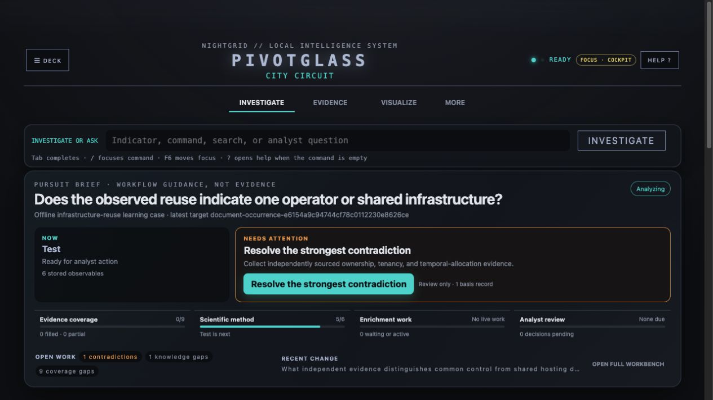

## View, reading, and attention

Open **Menu** (top left) **→ View** (also in Help) to fit the cockpit to your screen and eyes.
The choices persist in this browser and apply to every Pivotglass window.

| Control | Choices | Keys |
| --- | --- | --- |
| Width | **Column** (a 1180 px reading column), **Wide** (default, up to 1680 px, with Sources and Next step beside Activity), **Full** (the whole window) | `\` cycles |
| Text | **Compact**, **Standard**, **Large**, **Extra large**. Every label and value scales, including the rendered source in focus mode. Standard renders nothing smaller than 12 px | `+` / `−` |
| Density | **Comfortable** or **Compact** spacing | |

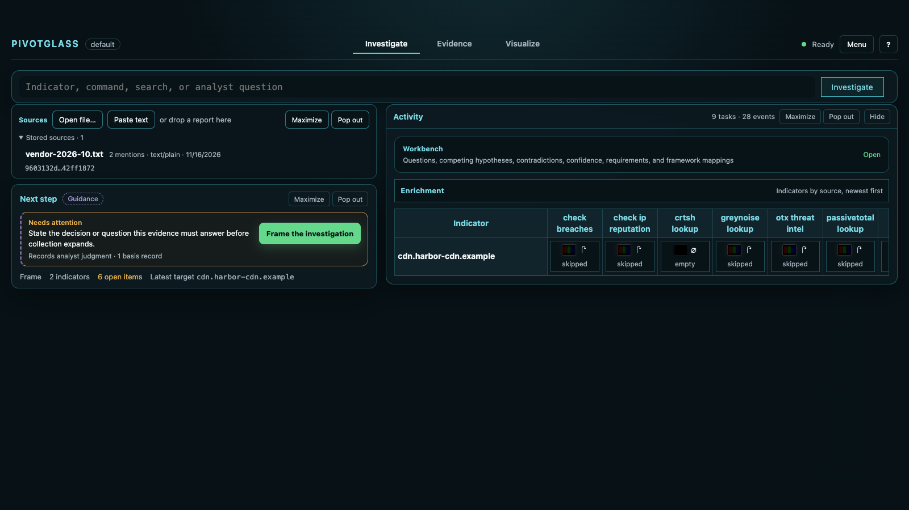

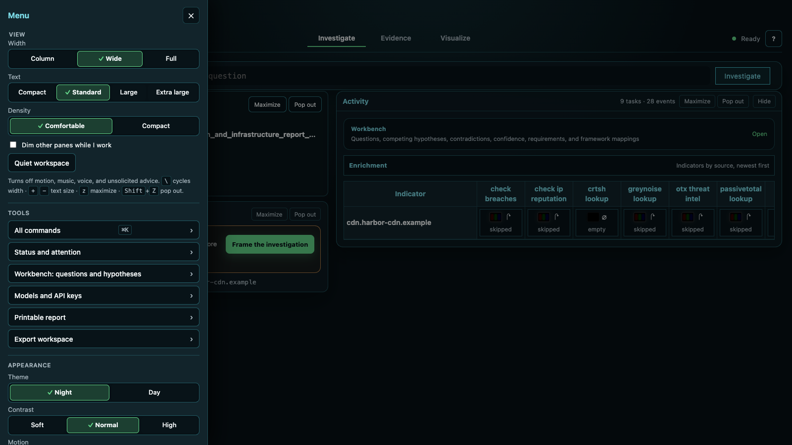

Every pane (Sources, Next step, Activity, Evidence, Visualize) has the same
icon controls at the right of its title: maximize (outward corners, `z`), pop
out (box with an arrow, `Shift`+`Z`), and collapse (chevron). Each names its
action on hover and to screen readers. Maximize fills the window with that
pane; Esc or restore (inward corners) returns. A maximized Sources pane is a
full-height paste area for long reports. Pop out opens the pane alone in its
own browser window for a second monitor; the window title names the pane. The
indicator evidence drawer has the same maximize and pop-out controls. Every window
reads the same local workspace, and view changes apply to all of them.
Browser zoom remains available.

**Dim other panes while I work** is off by default. Enabling it adds a
presentation-only spotlight when full visual effects are selected. Hover never
moves keyboard focus. Tutorial highlighting is separate and dismissible.

**Quiet workspace** turns off decorative motion, music, device voice,
unsolicited character advice, and hover dimming. It does not hide work, errors,
or manual Help. Restore individual options in Menu.

The **Utilities** dialog (Menu → Status and attention) keeps Tab and
Shift+Tab within its controls. Escape closes it and returns to its opener.
Help and other modal dialogs use the same focus handling. In TUI Help, use
Up/Down, Page Up/Page Down, Home/End, the wheel, or the scrollbar; Escape returns
to the command input without moving your history position.

For output, use **Menu → Printable report** or **Help → Create a report**.
Review before printing or saving. **Export workspace** opens the format
choices; it does not export until you select JSON, CSV, STIX, or GEXF.

During intake, the destination workspace is named above the file control.
Switching workspaces clears unfinished preview and selection. Writes from a
stale workspace are rejected before mutation. Library load failures show
**Retry**, not a misleading empty-library message. A stored receipt
and an entity-admission receipt remain separate.

After selected entities are successfully admitted, **Use [indicator]** puts
that exact value into the command input and focuses it. You still choose
**Investigate** to run enrichment. No tutorial button silently does that work.

## Safety boundary

External intelligence can be incomplete, stale, biased, or wrong. Treat source
responses as observations with provenance. Keep inference visibly separate.
Verify consequential conclusions at the originating service and preserve human
authority over pivots, publication, and other irreversible actions.

For installation and troubleshooting, return to the
[Quick Start](QUICKSTART.md). For the current documentation map, see the
[documentation index](README.md). Before sharing a diagnostic or filing an
issue, follow the privacy checklist in [Support](../SUPPORT.md). Release
maintainers use the [release trust ceremony](RELEASE_TRUST.md) to bind and
verify package archives, dependency inventories, checksums, and signatures.
